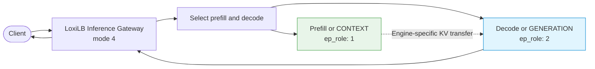
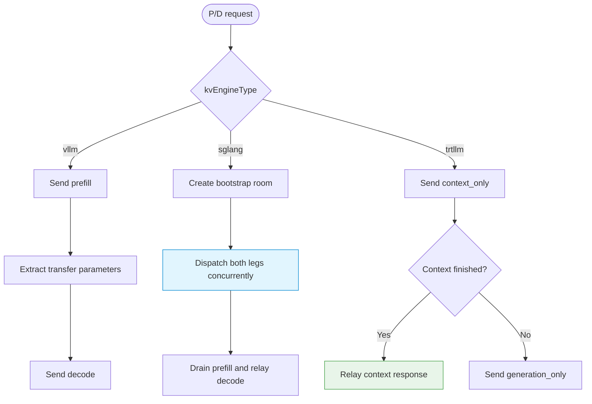

# P/D Disaggregation

Prefill/decode (P/D) disaggregation separates prompt processing from token generation. LoxiLB Inference Gateway selects the two endpoint roles and runs the request sequence required by the configured serving engine.

## Why separate prefill and decode?

- **Prefill** processes the input tokens and creates KV state. It is primarily compute intensive.
- **Decode** produces tokens iteratively while reading KV state. It is primarily memory-bandwidth sensitive.

P/D lets operators scale and tune those roles independently. It also adds network, engine-dialect, timeout, and failure-coupling requirements, so start with a converged pool unless the operational benefit is clear.

## Shared topology

Every P/D rule requires:

- `mode: 4` (fullproxy)
- `pd_disagg_mode: true`
- at least one `ep_role: 1` endpoint
- at least one `ep_role: 2` endpoint
- one coherent `kvEngineType` for the entire rule

!!! warning "HTTP/1.1 engine path"
    Current HTTP/2 tests qualify specific admission, authentication, accounting, multiplexing,
    and connection-lifecycle legs. The HTTP/2 forwarding path does not integrate P/D,
    model-aware pools, or KV-exact selection. Use the HTTP/1.1 fullproxy path for the P/D
    contracts on this page; do not generalize a passing HTTP/2 auth test into engine parity.

## The request flow depends on the engine

| Engine | Request order | Transfer contract | Engine-specific setting |
|---|---|---|---|
| vLLM | Sequential prefill, then decode | Gateway extracts `kv_transfer_params`; KV data moves through NIXL | Endpoint `nixl_port` |
| SGLang | Concurrent prefill and decode | Gateway injects one bootstrap host/port/room triple into both requests | `pdBootstrapPort` |
| TensorRT-LLM | Sequential CONTEXT, then GENERATION | Gateway extracts and relays `disaggregated_params`; context may finish early | Context and generation server roles |
| llama.cpp | Not supported | None | P/D configuration is rejected |

!!! warning "Do not copy fields across engines"
    `nixl_port`, `pdBootstrapPort`, ZMQ rank settings, and TensorRT-LLM's HTTP event drain solve different problems. A configuration that is valid for one engine can be rejected or meaningless for another.

## Optional cache-aware layers

P/D itself does not require `kvExactMode`.

- P/D always applies session stickiness first and falls back to load-aware endpoint selection.
- `pd_cache_aware_mode: true` adds the radix-trie prefix-affinity tier between those two stages.
- `kvExactMode: 1` adds engine-exact cache inventory selection for eligible prefill or context endpoints.
- `kvExactMode: 3` is not a P/D option; it is reserved for role-less single pools.

For KV-exact mode, the tokenizer, model identity, block/page size, hash contract, and event transport must match the engine. A rule can continue serving through fallback routing even when this parity is broken, so verify metrics explicitly.

## Configuration and execution

Use [Configuration and Arguments](../use-cases/configuration-tuning.md) for shared
P/D fields and timeout precedence. Follow the
[P/D deployment path](../use-cases/pd-deployment.md) for engine-specific commands,
readback, completed traffic, faults and cleanup. Common cache contract and
observability are maintained in [Engine Contracts](engine-contracts.md) and
[KV Routing Verification](../operations/kv-routing-verification.md).

### Lifecycle outcome contract

`loxilb_ai_pd_requests_total{model,phase,status}` records one terminal P/D lifecycle outcome. The
current closed mappings are:

| `phase` | `status` | Meaning |
|---|---|---|
| `complete` | `success` | Both required stages completed successfully. |
| `prefill` | `timeout` | The prefill-side lifecycle ran out of time. |
| `prefill` | `error` | The prefill endpoint or transport failed. |
| `prefill` | `rejected` | The prefill origin rejected the request and that response was relayed. |
| `decode` | `timeout` | Prefill completed, but decode produced no byte before its deadline. |
| `decode` | `error` | Prefill completed, but the decode endpoint or transport failed. |
| `unknown` | `error` | Defensive fallback for an unrecognized internal outcome; investigate as contract drift. |

`loxilb_ai_pd_kv_params_missing_total` is not a generic failure counter. It advances only after
the Gateway actually inspected a completed prefill response and found no `kv_transfer_params`.
Prefill timeout, death, or rejection does not count as "missing" because nothing was inspected.

`loxilb_ai_pd_tier_selected_total{tier,model}` increments once per successful prefill selection
with `tier0`, `tier1`, `tier15`, or `tier2`. Requests refused or parked by bounded admission do not
select a tier and therefore do not increment it. Diagnose admission with the separate
`shed`, `queued`, and `overflow_shed` families; a `429 pd_overloaded` must also have backend
receipt delta `0`.

## Failure diagnosis

| Symptom | Check first |
|---|---|
| Rule creation fails | Fullproxy mode, both endpoint roles, and engine-specific field coherence |
| Client request hangs | Engine request order, role health, transfer reachability, and first-byte timeouts |
| Decode recomputes the prompt | Engine transfer configuration and side-channel/bootstrap connectivity |
| Traffic succeeds but KV-exact hits remain zero | Tokenizer, model, block size, hash algorithm, event feed, and inventory readiness; `kvWarmupSec` is currently inert |
| One role becomes overloaded | Endpoint health, session TTL, load threshold, and role counts |
| Errors continue to select one endpoint | Circuit-breaker enablement and origin/connect failure classification |

Client-visible status and metric phase answer different questions. A `504` timeout should map to
the leg that actually timed out; an endpoint death commonly returns `503`; a prefill-origin 4xx is
relayed and recorded as `prefill/rejected`. Correlate the client receipt, backend delivery, the
typed `phase/status` counter, and engine logs instead of classifying by HTTP status alone.

### Circuit-breaker behavior

P/D rule creation enables a per-endpoint breaker with a three-connect-failure threshold and a
30-second open window in the current implementation. An enabled breaker also tracks
consecutive origin 5xx responses; the default origin threshold is three and
`LLB_PD_ORIGIN_ERR_THRESHOLD=0` disables that path. The current 5xx response is relayed to the
client. Opening the breaker demotes the endpoint for later selection; it does not replay the
failed request. A 4xx response neither advances nor resets the origin-5xx streak.

## Security considerations

- Isolate management, client, event, and engine-transfer networks according to their trust levels.
- Permit SGLang bootstrap or vLLM transfer ports only between the endpoints that need them.
- Do not expose TensorRT-LLM's destructive event endpoint to monitoring or untrusted consumers.
- Avoid logging request bodies or engine transfer objects when they may contain sensitive prompts or opaque state.
- P/D routing is not a tenant boundary. Apply authentication, authorization, and quota policies independently.

## Evidence limits

Repository validation proves configuration guards and deterministic mock request paths. It does not establish production throughput, latency, cache benefit, engine-version compatibility, cross-node fault tolerance, or secure network policy for a particular deployment.

## Next steps

- [SGLang P/D Disaggregation](sglang-pd-disaggregation.md)
- [TensorRT-LLM Integration](tensorrt-llm-integration.md)
- [vLLM Integration](vllm-integration.md)
- [Engine Capability Matrix](../concepts/engine-capability-matrix.md)

[Current reference](../use-cases/pd-deployment.md).

[Current reference](../use-cases/pd-deployment.md).
