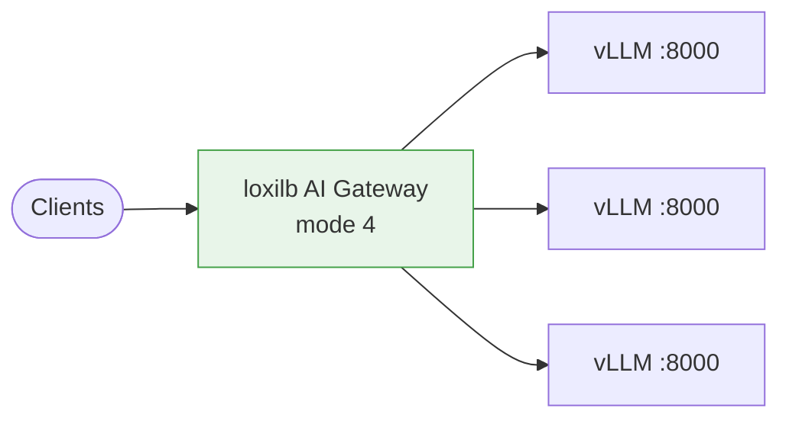
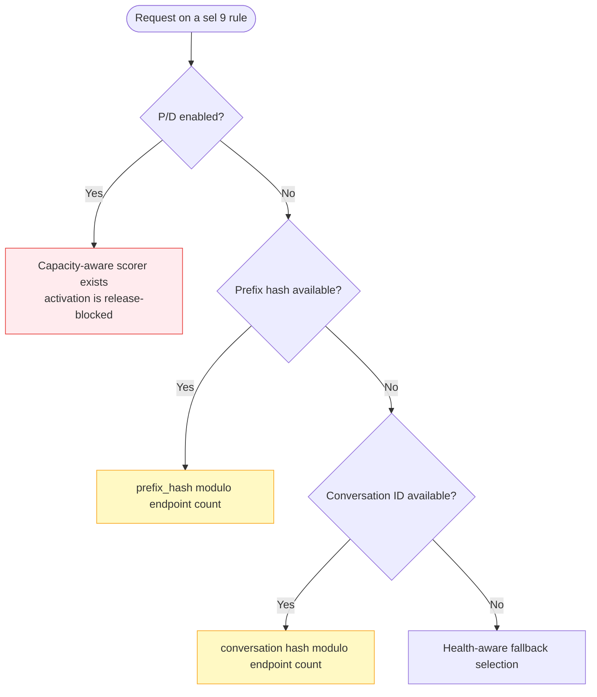

# vLLM Integration

--8<-- "snippets/common/mutation-fragment-notice.md"

!!! warning "Keep AI-aware vLLM rules on HTTP/1.1"
    Current HTTP/2 forwarding lacks model-aware pool lookup, selector 10, P/D, and KV-exact
    integration; selector 9 becomes round-robin. Treat HTTP/2 parity as a release gate.

Run vLLM behind the loxilb AI Gateway: the launch flags that must line up with the gateway, how to health-probe vLLM backends, backend protocol / ALPN, and the exact selector-9 metrics boundary.

## Concept

vLLM is the inference engine that actually runs the model on the GPU. loxilb fronts one or more vLLM instances as an L7 fullproxy (`mode: 4`) and spreads requests according to the selected routing law. Nothing special is required of vLLM to sit behind the gateway, but several launch flags must **match** the gateway's configuration for KV-aware features to work.



---

## Launch Flags That Matter

Use [Engine Contracts](engine-contracts.md#vllm-parity-triad) for the single
seed/hash/block/event contract. For the current vLLM 0.31.0 converged launch,
follow [Step 3](../use-cases/model-engine-standard/launch.md#matrix-engine-launch).
The separate [P/D reference](../use-cases/deploy-pd-disaggregation.md) has its
own connector and version qualification requirements.

`--enable-request-id-headers` is an optional engine diagnostic that exposes
request IDs in response headers; Gateway-internal correlation does not require
it. Client response IDs alone are not independent backend receipt evidence.

## Health Probing

vLLM exposes `/health`. Configure the allocated engine port and health path using
[shared probe fields](../use-cases/configuration-tuning.md#service-level-servicearguments).
HTTP health checks test the route; TCP probes establish only listener reachability.
Neither proves complete inference, successful P/D transfer or Exact readiness.
Use [Step 3](../use-cases/model-engine-standard/launch.md#verify-direct-engine-responses)
for direct model/chat checks and [Step 5](../use-cases/model-engine-standard/verify.md)
for completion and independent receipt verification.

## Backend Protocol and ALPN

`backend_protocol` sets the protocol loxilb negotiates toward the vLLM backends (via ALPN when TLS is in play):

| Value | Meaning |
|---|---|
| `http1` | HTTP/1.1 only. Default and safest — matches vLLM's OpenAI server. |
| `http2` | HTTP/2 only. |
| `both` | Advertise both HTTP/1.1 and HTTP/2 and let ALPN negotiate. |

`security` controls TLS on the service VIP:

| Value | Mode |
|---|---|
| `0` | Plaintext frontend and backend |
| `1` | Frontend TLS termination with a plaintext HTTP backend |
| `2` | Frontend TLS termination plus TLS re-encryption to the backend |

For a typical vLLM deployment, `backend_protocol: http1` with `security: 0` (plain) or `security: 1` (TLS termination on the VIP) is the right starting point.

---

## `sel: 9`: Current Topology-Dependent Behavior

The API and CLI call selector 9 `gpuaware`, but its current fullproxy behavior depends on the
service topology. Do not assume that the name means every rule reads the worker-metrics API.



- **Plain single pool:** selector 9 uses request affinity, not live GPU load. Adding or removing
  endpoints can remap modulo placements. Use CHWBL (`sel: 8`) when you need a stable hash ring and
  bounded-load protection, or round-robin (`sel: 0`) for independent requests.
- **P/D pool:** a capacity-aware Tier-2 scorer exists, but the current activation gate compares a
  mutable endpoint cursor instead of the configured selector. Configuring `sel: 9` therefore does
  not reliably enable it. Normal Tier 2 uses active connections plus queued requests. See
  [Routing Hierarchy](../use-cases/routing-hierarchy.md).
- **Worker-metrics control surface:** the GPU enable/status and worker-metrics APIs populate and
  report a separate metrics/eBPF surface. The current plain fullproxy selector does not read that
  surface. A successful metrics POST or `routing_mode: gpu_aware` status is therefore not proof of
  least-loaded selection for a plain pool.

!!! warning "Do not deploy from the historical least-loaded claim"
    For a plain fullproxy vLLM pool, do not use `sel: 9` as a production least-loaded-GPU policy.
    Treat P/D capacity scoring as unavailable until the activation field is corrected and the exact
    release artifact passes an end-to-end test. Use the selectors above when their documented
    behavior matches the workload.

---

## Verify

**GPU monitoring status** — `GET /config/gpu/status` reports the worker-metrics control surface:

```bash
curl -s "http://<loxilb>:11111/netlox/v1/config/gpu/status"
# {
#   "enabled": true,
#   "routing_mode": "gpu_aware",
#   "worker_count": 3,
#   "last_metrics_update": "...",
#   "ebpf_map_loaded": true
# }
```

`routing_mode` is `gpu_aware` when that surface is active or `standard_chwbl` when disabled.
This is a control-plane status, not proof that a plain fullproxy service is choosing the
least-loaded endpoint.

**Per-worker metrics** — `GET /config/worker/metrics` returns the current `WorkerMetricsEntry`
list stored on that separate surface:

```bash
curl -s "http://<loxilb>:11111/netlox/v1/config/worker/metrics"
```

**Selection algorithm** — confirm the service shows `sel: 9`:

```bash
curl -s "http://<loxilb>:11111/netlox/v1/config/loadbalancer/all" \
  | jq '.lbAttr[].serviceArguments | {externalIP, port, sel}'
```

---

## Troubleshooting

### `sel: 9` does not move traffic toward a less-loaded worker

For a plain single pool, this is expected: the current fullproxy path uses prefix/session modulo
placement and a healthy fallback, not the pushed worker metrics. Switch to CHWBL for bounded
prefix affinity, or round-robin for independent requests. For P/D, use the normal routing
hierarchy; do not depend on selector-9 capacity scoring in the current release.

### `/metrics` returns nothing

Treat this as an observability or metrics-agent problem, not the explanation for plain-pool
selector 9 placement. Confirm stats logging was not disabled and that the serving port is
reachable from the metrics collector.

### All endpoints show high queue depth

- The fleet is genuinely saturated — add vLLM instances.
- Enable KV-cache routing ([KV-Cache Routing](kv-caching.md)) to raise cache-hit rates and cut per-request work.
- Consider a smaller model or quantization to raise per-GPU throughput.

### Endpoints marked inactive

- The health probe is failing. Verify `probereq` (e.g. `/health`) and `probeport` match the vLLM serving port.
- Raise `probeTimeout` / `probeRetries` if backends are slow to start.
- Confirm the probe path returns success on the vLLM instance directly.

### KV-aware routing gets no cache hits

Almost always a launch-flag mismatch. Recheck `--block-size` vs `kvBlockSize`, `--prefix-caching-hash-algo` vs `kvHashAlgo`, and the KV-events port vs `kvZmqPort`. See [KV-Cache Routing](kv-caching.md) for the complete parity contract.

---

## Next Steps

- [LLM Routing](llm-routing.md) — CHWBL, selector-9 topology behavior, and weighted-hash selection
- [KV-Cache Routing](kv-caching.md) — block-hash KV-exact routing and the vLLM/SGLang parity contract
- [P/D Disaggregation](pd-disaggregation.md) — separate prefill and decode pools
- [Configuration Reference](configuration-reference.md) — all AI Gateway `serviceArguments`
