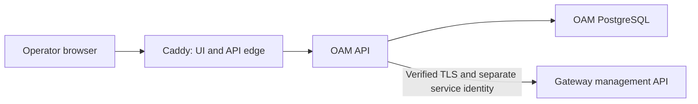

# Management & UI Overview

The management bundle is maintained in the OAM repository. Its Compose files
run Caddy, OAM, PostgreSQL, and a one-shot UI asset publisher. The browser opens
`/netlox/`; Caddy proxies `/api/oam/*` to OAM's `/oam/*` routes.

OAM login, OAM-to-Gateway management credentials, and inference API keys are
separate credentials. Current OAM strips the caller's Authorization header
before applying its configured Gateway service identity. The generic Compose
bundle defaults to `disabled`; its converged overlay selects `service-token`.
See the [installation guide](management-plane.md) for the exact source baseline
and configuration steps.

| Task | Guide |
|---|---|
| Install UI and OAM on Linux using Compose | [Deploy the Management Plane](management-plane.md) |
| Understand OAM credentials and instance registration | [LoxiLB OAM API](loxilb-oam.md) |
| Open and check the UI | [LoxiLB UI](loxilb-ui.md) |
| Configure Gateway metric export | [Monitoring and Metrics](../operations/monitoring.md) |

UI/OAM installation checks do not establish that a particular UI operation
works against a selected Gateway image. Validate required operations with that
exact release combination before using them on production resources.
