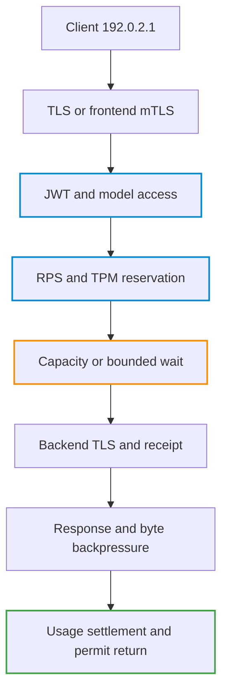

# Admission Control, Flow Control and QoS lab

Operate a request from identity validation through quota admission, bounded execution and resource return. Follow the chapters in order for a synthetic, single-node lab with independent backend receipts.

## Before you start

Choose this lab for identity, quota and capacity controls on one synthetic service.

**Focus of this page:** Follow the request from authentication through permit return.

## Topology and execution locations

--8<-- "snippets/use-cases/topology/admission.md"

These are Linux containers/namespaces on one disposable host. The model names identify synthetic echoes, not loaded GPU models. The baseline listener is VIP 192.0.2.254:2040; TLS, capacity and failure exercises add the explicit listener ports shown in their steps. Keycloak/JWKS and PostgreSQL use inspected Docker-bridge addresses.

| Where | What happens here |
|---|---|
| Host operator | Prepare private LAB files, issue credentials and run namespace commands. |
| l3h1 | Send management calls and client traffic into llb1. |
| llb1 | Enforce identity, quota and capacity before choosing a backend. |
| l3ep1 / l3ep2 | Observe independent Llama/Mistral receipt and hold/release fixtures. |
| kc-aigw / pg-jwtauth | Supply identity and policy state; they are not on the inference response path. |

## Reading path and reference

### Choose the operator task

| Task | Guide | Prerequisite |
|---|---|---|
| Build the isolated lab and issue credentials | [Preparation](setup.md) | Dedicated Linux host and selected image |
| Download the public JSON and TLS helper | [Lab inputs](downloads.md) | Docs checkout or individual downloads |
| Understand fields, units, readback and rollback | [Common API conventions](common.md) | Preparation |
| Authorize tenants and models | [JWT and model permissions](identity.md) | Keycloak and base echo |
| Encrypt either leg and authenticate both clients | [TLS and mTLS](tls.md) | Fresh local PKI |
| Control user/tenant/model RPS and TPM | [Quotas and reservations](quotas.md) | Per-user credentials |
| Share defaults and a service token budget | [Defaults and VIP budgets](defaults.md) | Scope backups |
| Forward identity and test dependency failure | [Policy faults and recovery](outages.md) | Disposable dependencies |
| Bound capacity, queues, SSE and maintenance | [Capacity and drain](capacity.md) | Hold/release fixture |
| Verify complete errors and resource return | [TLS failure qualification](tls-failures.md) | TLS chapter and extended fixture |
| Restore only the lab's resources | [Cleanup and diagnosis](cleanup.md) | Resource ownership record |

This is one integrated admission campaign. Chapters are grouped by operator purpose; their local numbered examples are not a numbering scheme for other routing, audit or model-engine campaigns. GAIE/llm-d request Priority is outside this lab. Endpoint selection weights, token budgets and capacity limits do not by themselves establish request execution priority.

### Request lifecycle

A JWT identifies tenant/user/model access; a quota controls request or token admission; a capacity permit limits running requests; byte backpressure paces forwarding. Each needs its own readback and traffic evidence. The normal inference path above does not imply parity for every HTTP framing, HTTP/2, P/D or non-inference path.

### Relationship to existing reference guides

Use this lab for complete operational sequences. The existing [traffic governance overview](../../ai-gateway/ai-traffic-governance.md), [admission reference](../../ai-gateway/admission-flow-control.md), [JWT reference](../../security/data-plane-jwt-auth.md), [backend TLS reference](../../security/backend-tls.md), [SSE accounting](../../ai-gateway/sse-quota-management.md) and [byte QoS guide](../../operations/ai-qos.md) remain the feature-level references. This lab concentrates shared options in the common page rather than reproducing the whole API dictionary in every chapter.

### Verification and evidence limits

This guide uses a single-node Ubuntu 24.04 lab with synthetic backends. Each exercise covers configuration, effective-state readback, allowed and denied traffic, independent backend receipts, and cleanup or rollback. TLS exercises also inspect response termination and resource accounting.

Match the examples to your deployed API, image and effective reservation/burst settings. TPM uses continuous token-bucket refill; a minute boundary is not a quota reset. Tiny-budget examples depend on prompt estimates and reservation settings, so their expected admission sequence must be checked against the deployed policy.

Documentation builds, schema checks and fixture compilation do not establish Gateway handshake success, backend delivery or resource return. Verify those behaviors with the traffic, receipt and accounting checks in each chapter. This synthetic lab does not establish production GPU performance, UI behavior, high availability or release qualification. An example inventory classification is not runtime evidence.

For deployment validation, record the immutable Gateway/eBPF/image/binary versions and run the positive, negative, recovery and scoped-cleanup checks. Record failed, skipped and unexecuted cases separately from successful results.

### Contract and source references

The [API schema reference](../../reference/api-schema-models.md) describes the site's frozen contract. Check it against your deployed Swagger. The implementation references are [JWT verification](https://github.com/loxilb-io/loxilb-inference-gateway/tree/main/pkg/jwtauth), [policy ladder and model-limit persistence](https://github.com/loxilb-io/loxilb-inference-gateway/tree/main/pkg/aikey), [token buckets and reservations](https://github.com/loxilb-io/loxilb-inference-gateway/tree/main/pkg/ratelimit), [admission and accounting integration](https://github.com/loxilb-io/loxilb-inference-gateway/blob/main/pkg/loxinet/ai_gateway_dp.go), [capacity fixtures](https://github.com/loxilb-io/loxilb-inference-gateway/tree/main/cicd/ai-admission) and [TLS fixtures](https://github.com/loxilb-io/loxilb-inference-gateway/tree/main/cicd/common/betls). These moving links locate code; they do not identify the immutable binary used by a runtime result.

Contributors can run the dedicated public package checks with `python3 -m unittest discover -s tests -p test_admission_examples.py -v`. They check every JSON asset, shell syntax, private-address hygiene, local links, management routes and file-backed request bodies (including the literal jq transformations). A negative schema mutation checks that invalid queue input is rejected by the validator. These tests do not execute management mutations.

## Check your result

Use the same lab across chapters; each control needs its own traffic and backend observation.

Compare API readback with the normal request, the deliberate denial, and an independent backend observation. Check the chapter's exact HTTP code and error body; HTTP 200 alone does not prove quota, identity, queue order, or resource return.

## Next steps and cleanup

Restore the chapter's temporary policy before continuing in the same lab. Keep the original configuration and private evidence; use the final cleanup chapter when the entire lab is finished. Read the [lab starting point](setup.md) if required values are missing. Use [cleanup and recovery](cleanup.md) when ending the run.
