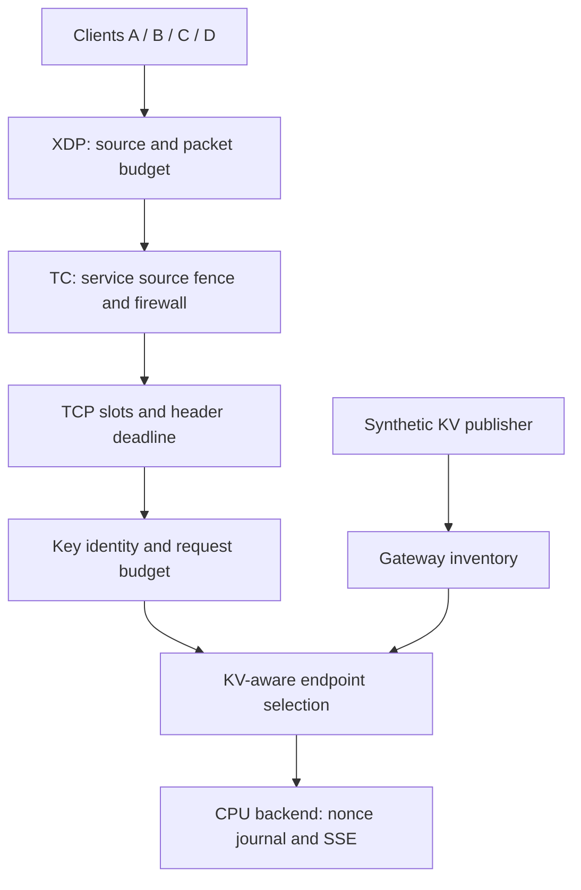

# Edge Cloud layered security lab

Keep authorized traffic working while applying source, service, connection and request protections on one Linux host.

## Choose the operator task

| Task | Chapter | Starts from |
|---|---|---|
| Obtain or customize the inputs | [Downloads](downloads.md) | This documentation revision |
| Build the seven-container CICD fixture | [Preparation](setup.md) | Dedicated Linux host |
| Interpret units, receipts and policy replacement | [Common conventions](common.md) | Baseline |
| Block sources and bound source/aggregate packet rate | [Source protection](source-protection.md) | Baseline |
| Fence a shared VIP and apply a TC rule | [Network boundary](network-boundary.md) | Source controls removed |
| Bound connections and incomplete headers | [Connections](connections.md) | Plain baseline |
| Authenticate keys and compare tenant budgets | [Request protection](request-protection.md) | Plain baseline |
| Retain KV routing, H2 and SSE with all controls on | [Coexistence](coexistence.md) | Isolated controls proved |
| Restore policy and recover the key store | [Recovery](recovery.md) | All-on tuple |
| Verify peer deletion and remove owned resources | [Cleanup](cleanup.md) | Recovered store |
| Understand advanced validation limits | [Advanced boundaries](advanced.md) | Core lab understood |

## Request and evidence paths

An early source drop, a refused TCP connection and an HTTP 401/429 are different results.
Observe the owning layer alongside a normal control request. A saved policy is not delivery proof.

## Relationship to existing guides

This lab owns the *sequence* and its lab inputs. Use [API keys](../../ai-gateway/api-key-management.md)
for the complete key API, [admission](../../ai-gateway/admission-flow-control.md) for queues and tenant
share, [QoS](../../operations/ai-qos.md) for byte-rate measurement, and the
[admission lab](../admission-flow-control/index.md) for JWT/TPM/TLS workflows.
Read [KV concepts](../../concepts/kv-routing.md) before the coexistence exercise and
[backup/restore](../../operations/backup-restore.md) before recovery. Those workflows do not need to be
run to build this lab. OPA watcher, UI/OAM, content/PII scanning and GPU deployment are outside it.

## Verification and evidence limits

The examples pin Gateway source `0f78cc3329e23934be4924069b137bfbe557e8f2` and its submodules. This is a development-source
lab, not a claim that an older release implements every field. Build and record the matching image;
do not substitute a floating image tag. The CPU fixture and synthetic KV events prove bounded
routing/delivery behavior, not model cache reuse, native NIC throughput, HA, DDoS capacity or a tenant SLA.

Run the chapters in order with an unshared lab. Each case needs configuration/readback, positive and
negative traffic, independent backend receipt, applicable counter evidence, recovery and cleanup.
Keep failed, skipped and unrun results separate. Static/schema/build checks are separate from Linux
runtime proof. [Advanced boundaries](advanced.md) identifies experiments this core lab does not qualify.
