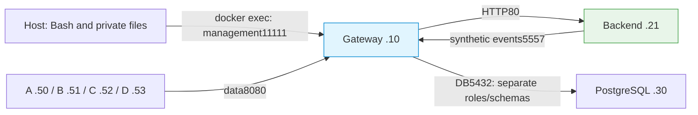

# Prepare a single-host security lab

Use pinned CICD fixtures for infrastructure and individual REST commands for the policy exercises.

<!-- example-status-default: illustrative-only -->

## Prerequisites and conflict checks

Use rootful Docker on a dedicated Ubuntu24.04 amd64 Linux host. Allow 4 cores, 8 GiB RAM and
30 GiB free disk for a source build. Containers share the host kernel; the Gateway needs privileged
eBPF access. Install tools using [installation](../../getting-started/installation.md) and
[system requirements](../../reference/system-requirements.md): Bash, Git, Python3 with venv, jq,
OpenSSL, iproute2, util-linux/nsenter and tcpdump. The CICD client image supplies HTTP/2 curl.
Build requires registries, apt, Go/GitHub and PyPI access. Do not replace an existing host runtime.
Download the [lab input directory](downloads.md) as `lab-inputs` in the directory from which you
start the commands below. It must be the same revision as this tutorial.

Run the remaining commands in one **root Bash** on that server. Use a new directory; preserve
existing configuration and evidence. No UI, OAM, Keycloak, GPU or model weights are required.

```bash
sudo -i
bash
umask 077
mkdir edge-security-lab
cd edge-security-lab
export WORK="$PWD"
export INPUTS="$WORK/lab-inputs"
cp -a ../lab-inputs "$INPUTS"
(cd "$INPUTS" && sha256sum -c SHA256SUMS)
docker ps -a --no-trunc --format '{{.ID}} {{.Names}} {{.State}}' | sort > "$WORK/containers-before.txt"
docker network ls
ip -4 route show table all
docker info --format '{{json .SecurityOptions}}'
df -h .
command -v git python3 jq openssl nsenter tcpdump
```

Expect no rootless Docker and no existing `uc7-gw`, `uc7-pg`, `uc7-ep`, `uc7-a/b/c/d` or
`uc7-security` network. These are the public CICD resource names; they do not identify other use-case
numbers. If a name or `192.0.2.0/24` route/subnet is in use, stop without deleting it.

The copy above places the already-downloaded public inputs inside the new lab and verifies their hashes. Keep input acquisition separate from private runtime state.

## Acquire pinned sources and build fixture images

The [public CICD scenario](https://github.com/loxilb-io/loxilb-inference-gateway/tree/0f78cc3329e23934be4924069b137bfbe557e8f2/cicd/edge-cloud-security)
owns build/preflight/bootstrap/owner-checked teardown. Use it for infrastructure, then perform policy
changes individually. Adapt only its test-network prefix, before the build locks command hashes.
Do not edit Gateway/eBPF product code or run the original automatic validation against a manually
mutated lab. Full source/submodule/image identities belong in your private result record.

```bash
git clone --recurse-submodules https://github.com/loxilb-io/loxilb-inference-gateway.git gateway
cd gateway
git checkout --detach 0f78cc3329e23934be4924069b137bfbe557e8f2
git submodule update --init --recursive
export SRC="$PWD"
git rev-parse HEAD
git submodule status
sed -i 's/172[.]30[.]97[.]/192.0.2./g' cicd/edge-cloud-security/commands.json cicd/edge-cloud-security/*.py
git diff --stat
export EDGE_STATE="$WORK/private-state"
docker build --build-arg OPENSSL_BUILD_CPUS=2 --build-arg VERSION=edge-tutorial -t edge-tutorial-gateway:local .
export EDGE_GATEWAY_IMAGE=$(docker image inspect edge-tutorial-gateway:local --format '{{.Id}}')
EDGE_GATEWAY_IMAGE="$EDGE_GATEWAY_IMAGE" EDGE_STATE="$EDGE_STATE" bash cicd/edge-cloud-security/build.sh
export EDGE_VENV="$EDGE_STATE/venv"
jq '{gateway:.gateway.id,client:.client.id,backend:.backend.id,postgres:.postgres.id,source:.source}' "$EDGE_STATE/images.json"
EDGE_STATE="$EDGE_STATE" bash cicd/edge-cloud-security/preflight.sh
EDGE_STATE="$EDGE_STATE" bash cicd/edge-cloud-security/config.sh
export LAB=$(jq -er .lab "$EDGE_STATE/active.json")
export API='http://127.0.0.1:11111/netlox/v1'
export VIP='192.0.2.10'
export RUN="edge-$(date -u +%Y%m%dT%H%M%SZ)"
jq -r '.token | "header = \"Authorization: Bearer " + . + "\""' "$LAB/login.private.json" > "$LAB/control.curl"
docker cp "$LAB/control.curl" uc7-gw:/etc/loxilb/control.curl
docker exec uc7-gw chmod 600 /etc/loxilb/control.curl
```

`OPENSSL_BUILD_CPUS=2` bounds that build stage's concurrency; it is not a runtime policy. `SRC` is
the host checkout, `WORK` its parent, `EDGE_STATE` the private lifecycle/image-lock root, and `LAB`
the new run directory selected by CICD. Keep the same values in every terminal. Build locks local
image IDs; base packages are mutable, so source pin alone does not promise byte-identical rebuilds.
`preflight.sh` rejects collisions and drift. `config.sh` runs infrastructure SET commands only:
network, seven containers, fresh DB role/schema setup, Gateway process and first administrator.
Require its successful setup stage, not just container presence. Its generated password is private.
Read [management authentication](../../security/management-api-authentication.md) for role/bootstrap
semantics. Never print or commit `login.private.json`, state/DB directories or curl credential files.

## Topology and execution locations



All addresses are on isolated `192.0.2.0/24`; Docker assigns its bridge gateway independently.
No host port is published. The publisher later runs in the backend network namespace, using the
host's private venv/files. `docker exec -i ... < "$LAB/file"` streams a **host** file to curl `@-`;
`--config /run/edge-key.curl` reads a **container** credential file. Management `API` is localhost
inside `uc7-gw`, whereas inference `VIP` is reached from A/B/C/D.

## Configure a plain baseline and issue one lab key

Start without KV or source ACLs so that isolated controls cannot hide one another's failures.
The fullproxy rule uses the synthetic model label and CPU fixture; the label does not deploy Qwen.

```bash
cat > "$LAB/model.json" <<'JSON'
{
  "serviceArguments": {
    "externalIP": "192.0.2.10",
    "port": 8080,
    "protocol": "tcp",
    "mode": 4,
    "host": "192.0.2.10",
    "model_name": "Qwen/Qwen3-0.6B",
    "inactiveTimeOut": 60,
    "connectionLimit": 4,
    "api_key_auth": "required"
  },
  "endpoints": [
    {
      "endpointIP": "192.0.2.21",
      "targetPort": 80,
      "weight": 1
    }
  ]
}
JSON
docker exec -i uc7-gw curl -sS --max-time 20 --config /etc/loxilb/control.curl -X POST -H 'Content-Type: application/json' --data-binary @- -w '\nHTTP:%{http_code}\n' "$API/config/loadbalancer" < "$LAB/model.json"
```

```bash
cat > "$LAB/key-create.json" <<'JSON'
{
  "tenant_id": "edge-team",
  "name": "edge-client",
  "allowed_models": [
    "Qwen/Qwen3-0.6B"
  ],
  "rate_limit_rps": 0,
  "burst_size": 0,
  "tokens_per_min": 100000,
  "enabled": true
}
JSON
docker exec -i uc7-gw curl -fsS --config /etc/loxilb/control.curl -H 'Content-Type: application/json' --data-binary @- "$API/config/ai/apikey" < "$LAB/key-create.json" > "$LAB/key.private.json"
export KEY_ID=$(jq -er .key_id "$LAB/key.private.json")
jq -r '.raw_key | "header = \"X-Api-Key: " + . + "\""' "$LAB/key.private.json" > "$LAB/key.curl"
docker cp "$LAB/key.curl" uc7-a:/run/edge-key.curl
docker cp "$LAB/key.curl" uc7-b:/run/edge-key.curl
docker cp "$LAB/key.curl" uc7-c:/run/edge-key.curl
docker cp "$LAB/key.curl" uc7-d:/run/edge-key.curl
sleep 15
```

```bash
docker exec uc7-gw curl -fsS --max-time 20 --config /etc/loxilb/control.curl "$API/config/loadbalancer/all" > "$LAB/baseline-lb.json"
jq '.lbAttr[] | {serviceArguments,endpoints,allowedSources}' "$LAB/baseline-lb.json"
docker exec -i uc7-a curl -sS --http1.1 --connect-timeout 2 --max-time 6 --config /run/edge-key.curl -H 'Content-Type: application/json' -H "X-Edge-Nonce: $RUN-baseline" --data-binary @- -w '\nHTTP:%{http_code} VERSION:%{http_version}\n' "http://$VIP:8080/v1/completions" < "$LAB/request.json" > "$LAB/baseline.txt" 2> "$LAB/baseline.err"
printf 'CURL_EXIT=%s\n' "$?"
cat "$LAB/baseline.txt"
docker logs uc7-ep > "$LAB/journal.jsonl" 2>&1
jq -s --arg nonce "$RUN-baseline" '[.[] | select(.event=="uc7_receipt" and .nonce==$nonce)] | {count:length,credentials_absent:all(.key_present==false),protocols:map(.proto)}' "$LAB/journal.jsonl"
docker exec -i uc7-a curl -sS --http1.1 --connect-timeout 2 --max-time 6 -H 'Content-Type: application/json' -H "X-Edge-Nonce: $RUN-missing" --data-binary @- -w '\nHTTP:%{http_code} VERSION:%{http_version}\n' "http://$VIP:8080/v1/completions" < "$LAB/request.json" > "$LAB/missing.txt" 2> "$LAB/missing.err"
printf 'CURL_EXIT=%s\n' "$?"
cat "$LAB/missing.txt"
docker logs uc7-ep > "$LAB/journal.jsonl" 2>&1
jq -s --arg nonce "$RUN-missing" '[.[] | select(.event=="uc7_receipt" and .nonce==$nonce)] | {count:length,credentials_absent:all(.key_present==false),protocols:map(.proto)}' "$LAB/journal.jsonl"
```

## Expected results, cleanup and troubleshooting

Require LB HTTP 200, a key response containing nonempty `key_id` and private `raw_key`, and baseline
HTTP 200/curl 0/receipt 1 with `credentials_absent:true`. Missing key is HTTP 401/curl 0/receipt 0.
Readiness/GET 200 is not a replacement for that baseline. Stop if any check fails.
The key has RPS0/burst0 here to isolate packet/connection controls; quotas and request limits come later.
No token value should appear in command arguments or response artifacts.

Keep the bootstrap running between chapters. On failure inspect the private boot logs and source/image
identity, DB readiness and routes; do not treat timeout as denial. Partial setup is cleaned only with
[owned cleanup](cleanup.md). Generated keys/DB/snapshots remain local, outside a public checkout.
Continue to [common conventions](common.md), then [source protection](source-protection.md).
