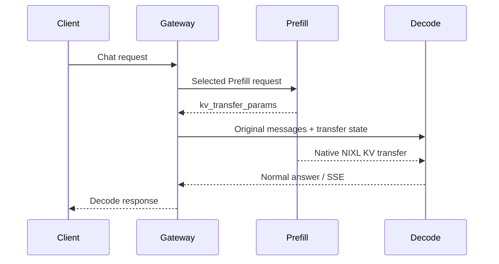
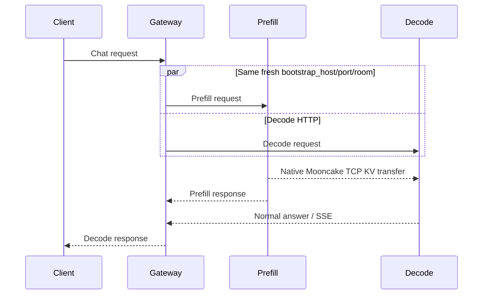

# Existing profiles: native P/D launch and verification

<!-- example-status-default: illustrative-only -->

This is an **optional separate topology**, after a normal two-worker converged RR check. Prefill processes the input; Decode generates output using state transferred by the native engine. A completed chat response alone does not prove P/D transfer. [Start with the results guide](existing-profiles.md); the table below lists the only P/D recipes supplied.

## Before you start

Complete the documented converged baseline, clean up its native workers, and select a supplied P/D recipe.

**Focus of this page:** Choose 2P1D for the supplied vLLM recipes or 1P1D for the supplied SGLang recipes.

## Topology and execution locations

--8<-- "snippets/use-cases/topology/pd.md"

Prefill and decode are separate workers. The solid lines are request/control paths; the dashed worker-to-worker edge is engine-specific KV transfer and needs its own ports, version compatibility and evidence. An HTTP route or an accepted config is not transfer proof. Follow only the selected engine runbook.

| Where | What happens here |
|---|---|
| Operator terminal | Select the version tuple, private run directory, model snapshot and profiles. |
| Gateway host / namespace | Start the dedicated Gateway; apply and read back only the selected service. |
| Each worker host | Launch the chosen engine and prove direct inference before Gateway traffic. |
| Client | Send the same request through the Gateway and retain its HTTP/SSE observations. |
| Independent evidence | Correlate worker requests/receipts with the selected rule and request identifiers. |

## Walkthrough

### 1. Select a permitted P/D scope {#select-pd}

| Profile ID | vLLM P/D | SGLang P/D |
|---|---|---|
| `olmo2-0425-1b-v1` | [2P1D; base, exact](../../assets/existing-profiles/settings/olmo2-0425-1b-v1-vllm-pd.env) | [1P1D; base, exact](../../assets/existing-profiles/settings/olmo2-0425-1b-v1-sglang-pd.env) |
| `r1-distill-qwen-15b-v1` | [2P1D; base, exact](../../assets/existing-profiles/settings/r1-distill-qwen-15b-v1-vllm-pd.env) | [1P1D; base](../../assets/existing-profiles/settings/r1-distill-qwen-15b-v1-sglang-pd.env) |
| `gemma3-1b-it-v1` | No verified recipe | No verified recipe |
| `gemma4-e2b-it-v1` | No verified recipe | [1P1D; base, exact](../../assets/existing-profiles/settings/gemma4-e2b-it-v1-sglang-pd.env) |
| `llama32-1b-v1` | No verified recipe | No verified recipe |
| `exaone4-12b-v1` | [2P1D; base, exact](../../assets/existing-profiles/settings/exaone4-12b-v1-vllm-pd.env) | [1P1D; base, exact](../../assets/existing-profiles/settings/exaone4-12b-v1-sglang-pd.env) |
| `phi4-mini-instruct-v1` | [2P1D; base, exact](../../assets/existing-profiles/settings/phi4-mini-instruct-v1-vllm-pd.env) | [1P1D; base, exact](../../assets/existing-profiles/settings/phi4-mini-instruct-v1-sglang-pd.env) |
| `granite42-3b-v1` | [2P1D; base, exact](../../assets/existing-profiles/settings/granite42-3b-v1-vllm-pd.env) | [1P1D; base, exact](../../assets/existing-profiles/settings/granite42-3b-v1-sglang-pd.env) |
| `ministral3-3b-v1` | No verified recipe | [1P1D; base](../../assets/existing-profiles/settings/ministral3-3b-v1-sglang-pd.env) |
| `ax31-light-v1` | [2P1D; base, exact](../../assets/existing-profiles/settings/ax31-light-v1-vllm-pd.env) | [1P1D; base, exact](../../assets/existing-profiles/settings/ax31-light-v1-sglang-pd.env) |
| `qwen36-27b-fp8-v1` | No verified recipe | No verified recipe |
| `qwen38-27b-fp8-v1` | No verified recipe | [1P1D; base, exact](../../assets/existing-profiles/settings/qwen38-27b-fp8-v1-sglang-pd.env) |
| `gptoss-20b-v1` | No verified recipe | [1P1D; base, exact](../../assets/existing-profiles/settings/gptoss-20b-v1-sglang-pd.env) |

`base` means role/load-aware selection, not converged RR. `exact` on a one-Prefill topology proves engagement/transfer, not a choice between Prefills. No new TRT inference ran. A missing P/D settings/rule file is an explicit stop condition; do not reuse a converged file or another model's parameters.

Complete the [launch guide](existing-profiles-launch.md) for your selected profile/engine first. For an additional Decode host in 2P1D, run its [package/identity setup](existing-profiles-launch.md#select-and-save) and [worker preparation](existing-profiles-launch.md#worker-artifacts) first to create that host's `operator.env` and model snapshot; do not launch a converged engine there. Finish its rule, collector, and native-container cleanup before switching to P/D. Keep weights, the package, Gateway deployment, and private evidence. The same ports are reused, so ordinary native containers or collectors must not remain listening.

**Every participating shell:** restore that machine's saved settings. On the Gateway shell choose `PD_ROUTING=base` first; Exact is a separate run after cleanup.

```bash
set -e
export WORK="$HOME/igw-existing-profile-evaluation"
source "$WORK/operator.env" || exit 1
export PD_ROUTING=base
test -f "$PACKAGE/settings/$PROFILE-$ENGINE-pd.env" || exit 1
test -f "$PACKAGE/rules/$PROFILE-$ENGINE-pd-$PD_ROUTING.json" || exit 1
source "$PACKAGE/settings/$PROFILE-$ENGINE-pd.env" || exit 1
PD_RUN="$RUN/pd-$(date -u +%Y%m%dT%H%M%S)-$RANDOM"
export PD_RUN
PD_RID="pd-$(date -u +%Y%m%dT%H%M%S)-$RANDOM"
export PD_RID
mkdir -p "$PD_RUN"
declare -p PD_ROUTING PD_RUN PD_RID > "$RUN/pd-operator.env"
cd "$PD_RUN" || exit 1
printf 'profile=%s engine=%s topology=%s mode=%s output=%s\n' "$PROFILE" "$ENGINE" "$PD_TOPOLOGY" "$PD_ROUTING" "$PD_MAX_OUTPUT"
```

Keep `PD_RUN` and `PD_RID` from this terminal for the remainder of its run; do not recreate them while collecting evidence. For an **extra terminal on the same host**, restore the saved P/D selection:

```bash
set -e
export WORK="$HOME/igw-existing-profile-evaluation"
source "$WORK/operator.env" || exit 1
source "$RUN/pd-operator.env" || exit 1
source "$PACKAGE/settings/$PROFILE-$ENGINE-pd.env" || exit 1
cd "$PD_RUN" || exit 1
```

Gateway request IDs must be copied to worker verification terminals, not replaced with worker-local IDs. One active attempt per host is assumed; `pd-operator.env` points to its local evidence directory.

### 2. Allocate roles and verify readiness prerequisites {#pd-role-preparation}

| Role | Documentation address | Native HTTP | Receipt HTTP | Additional connectivity |
|---|---|---|---|---|
| Prefill1 |192.0.2.21|18300|18301|Prefill inventory5557 to Gateway; native transfer between roles|
| Prefill2 for 2P1D / Decode for 1P1D |192.0.2.22|18300|18301|vLLM side channel5600 or SG bootstrap18998|
| Decode for 2P1D |192.0.2.23|18300|18301|vLLM side channel5600|

Replace addresses with allocated hosts in both native arguments and rule JSON. Successful vLLM recipes used two L4 Prefills plus one L40S Decode (2P1D). SG recipes used two L40S GPUs (1P1D). Failed Qwen vLLM attempts instead used 1P1D/two L40S and provide **no recipe**. Do not treat their hardware as a successful 2P1D configuration.

On every role, verify the same full model snapshot/checksums from [worker preparation](existing-profiles-launch.md#worker-artifacts), Docker GPU access, free ports, and the exact image. Mount all roles' weights at `/qa/model:ro`. `PD_MEMORY_ARGS` is the recorded Docker host RAM array; `PD_GPU_BLOCKS` is matched vLLM KV geometry, not an optimal capacity recommendation. Do not copy converged caps or memory limits into P/D.

### 3. Launch only the selected engine {#pd-native-launch}

#### vLLM: CPU NIXL/UCX TCP

**Each vLLM role:**

```bash
test "$ENGINE" = vllm || exit 1
source "$PACKAGE/settings/$PROFILE-vllm-pd.env" || exit 1
export ENGINE_IMAGE='vllm/vllm-openai@sha256:a4a4c0437bf7240089da5f08aa370c4aee17ae5290f7a3b468825ee26c4c3a6b'
docker pull "$ENGINE_IMAGE"
docker image inspect "$ENGINE_IMAGE" --format '{{.Id}} {{json .RepoDigests}}'
```

**Each Prefill:** run on Prefill1 and Prefill2 for 2P1D. In the second terminal replace `WORKER_IP` with that Prefill's own allocated address. Replace `eth0` with the authorized transfer interface without changing host NIC configuration.

```bash
export WORKER_IP=192.0.2.21
docker run -d --name existing-profile-vllm-prefill --label igw.qa=existing-profile-evaluation \
  --gpus all "${PD_MEMORY_ARGS[@]}" --network host --ipc host --shm-size 8g --ulimit memlock=-1 \
  -e HF_HUB_OFFLINE=1 -e HF_MODULES_CACHE=/tmp/hf_modules -e PYTHONHASHSEED=0 \
  -e VLLM_KV_EVENTS_USE_INT_BLOCK_HASHES=1 -e UCX_TLS=tcp -e UCX_NET_DEVICES=eth0 \
  -e VLLM_NIXL_SIDE_CHANNEL_HOST="$WORKER_IP" -e VLLM_NIXL_SIDE_CHANNEL_PORT=5600 \
  "${VLLM_PD_MODEL_ENVS[@]}" -v "$MODEL_DIR:/qa/model:ro" "$ENGINE_IMAGE" \
  --model /qa/model --revision "$REV" --tokenizer-revision "$REV" \
  --served-model-name "$MODEL" --host 0.0.0.0 --port 18300 --dtype auto \
  --max-model-len 4096 --max-num-seqs 2 --max-num-batched-tokens 4096 \
  --gpu-memory-utilization 0.85 --enforce-eager --enable-prefix-caching \
  --prefix-caching-hash-algo sha256_cbor --block-size 16 --prefix-match-unit 16 \
  "${VLLM_PD_ATTENTION_ARGS[@]}" --num-gpu-blocks-override "$PD_GPU_BLOCKS" \
  --kv-events-config '{"enable_kv_cache_events":true,"publisher":"zmq","endpoint":"tcp://*:5557","topic":""}' \
  --kv-transfer-config '{"kv_connector":"NixlConnector","kv_role":"kv_producer","kv_buffer_device":"cpu","kv_load_failure_policy":"fail","kv_connector_extra_config":{"backends":["UCX"],"kv_lease_duration":30}}' \
  "${VLLM_PD_MODEL_ARGS[@]}"
```

**Decode:** the supplied vLLM recipes are2P1D, so the block uses the third worker, `.23`. The rule must use the same address.

```bash
export WORKER_IP=192.0.2.23
docker run -d --name existing-profile-vllm-decode --label igw.qa=existing-profile-evaluation \
  --gpus all "${PD_MEMORY_ARGS[@]}" --network host --ipc host --shm-size 8g --ulimit memlock=-1 \
  -e HF_HUB_OFFLINE=1 -e HF_MODULES_CACHE=/tmp/hf_modules -e PYTHONHASHSEED=0 \
  -e VLLM_KV_EVENTS_USE_INT_BLOCK_HASHES=1 -e UCX_TLS=tcp -e UCX_NET_DEVICES=eth0 \
  -e VLLM_NIXL_SIDE_CHANNEL_HOST="$WORKER_IP" -e VLLM_NIXL_SIDE_CHANNEL_PORT=5600 \
  "${VLLM_PD_MODEL_ENVS[@]}" -v "$MODEL_DIR:/qa/model:ro" "$ENGINE_IMAGE" \
  --model /qa/model --revision "$REV" --tokenizer-revision "$REV" \
  --served-model-name "$MODEL" --host 0.0.0.0 --port 18300 --dtype auto \
  --max-model-len 4096 --max-num-seqs 2 --max-num-batched-tokens 4096 \
  --gpu-memory-utilization 0.85 --enforce-eager --enable-prefix-caching \
  --prefix-caching-hash-algo sha256_cbor --block-size 16 --prefix-match-unit 16 \
  "${VLLM_PD_ATTENTION_ARGS[@]}" --num-gpu-blocks-override "$PD_GPU_BLOCKS" \
  --kv-transfer-config '{"kv_connector":"NixlConnector","kv_role":"kv_consumer","kv_buffer_device":"cpu","kv_load_failure_policy":"fail","kv_connector_extra_config":{"backends":["UCX"],"kv_lease_duration":30}}' \
  "${VLLM_PD_MODEL_ARGS[@]}"
```

All roles must use the same recorded block count and compatible geometry. Decode does not publish inventory. A running process or enough VRAM alone does not prove a working NIXL transfer.

#### SGLang: Mooncake TCP

**Both SG roles:**

```bash
test "$ENGINE" = sglang || exit 1
source "$PACKAGE/settings/$PROFILE-sglang-pd.env" || exit 1
export ENGINE_IMAGE='lmsysorg/sglang@sha256:37bbbd3444732a464bbc68dee4fb0164e0ce9e18e2f027f3fc967f1152d3c262'
docker pull "$ENGINE_IMAGE"
docker image inspect "$ENGINE_IMAGE" --format '{{.Id}} {{json .RepoDigests}}'
```

**Prefill on the first L40S worker:**

```bash
docker run -d --name existing-profile-sg-prefill --label igw.qa=existing-profile-evaluation \
  --gpus all "${PD_MEMORY_ARGS[@]}" --network host --ipc host --shm-size 8g \
  -e HF_HUB_OFFLINE=1 -e HF_MODULES_CACHE=/tmp/hf_modules -e PYTHONHASHSEED=0 \
  -e MOONCAKE_PROTOCOL=tcp -e SGLANG_DISAGGREGATION_BOOTSTRAP_TIMEOUT=45 \
  -e SGLANG_DISAGGREGATION_WAITING_TIMEOUT=45 -v "$MODEL_DIR:/qa/model:ro" \
  --entrypoint python3 "$ENGINE_IMAGE" -m sglang.launch_server \
  --model-path /qa/model --revision "$REV" --served-model-name "$MODEL" \
  --host 0.0.0.0 --port 18300 --dtype auto --context-length 4096 \
  --mem-fraction-static 0.85 --max-running-requests 2 --chunked-prefill-size 4096 \
  --page-size 16 --disable-cuda-graph --enable-metrics \
  --kv-events-config '{"publisher":"zmq","endpoint":"tcp://*:5557"}' \
  --disaggregation-mode prefill --disaggregation-transfer-backend mooncake_tcp \
  --disaggregation-bootstrap-port 18998 --max-total-tokens 8192 "${SGLANG_PD_MODEL_ARGS[@]}"
```

**Decode on the second L40S worker:**

```bash
docker run -d --name existing-profile-sg-decode --label igw.qa=existing-profile-evaluation \
  --gpus all "${PD_MEMORY_ARGS[@]}" --network host --ipc host --shm-size 8g \
  -e HF_HUB_OFFLINE=1 -e HF_MODULES_CACHE=/tmp/hf_modules -e PYTHONHASHSEED=0 \
  -e MOONCAKE_PROTOCOL=tcp -e SGLANG_DISAGGREGATION_BOOTSTRAP_TIMEOUT=45 \
  -e SGLANG_DISAGGREGATION_WAITING_TIMEOUT=45 -v "$MODEL_DIR:/qa/model:ro" \
  --entrypoint python3 "$ENGINE_IMAGE" -m sglang.launch_server \
  --model-path /qa/model --revision "$REV" --served-model-name "$MODEL" \
  --host 0.0.0.0 --port 18300 --dtype auto --context-length 4096 \
  --mem-fraction-static 0.85 --max-running-requests 2 --chunked-prefill-size 4096 \
  --page-size 16 --disable-cuda-graph --enable-metrics \
  --disaggregation-mode decode --disaggregation-transfer-backend mooncake_tcp \
  --disaggregation-bootstrap-port 18998 --max-total-tokens 8192 "${SGLANG_PD_MODEL_ARGS[@]}"
```

Preserve model-specific attention/reasoning arguments. Do not add Decode inventory publication or an unqualified decode-radix-cache flag. Native memory-pool8192 and chunk size4096 are separate from the4096-token context and request output budget.

#### Check every role and start its receipt collector

On each role set its actual container name, then check readiness and served model. Do **not** send an ordinary standalone chat request to a disaggregated role as a readiness test; SG roles require coordinated bootstrap state.

```bash
export ENGINE_CONTAINER=existing-profile-vllm-prefill
docker logs --tail 100 "$ENGINE_CONTAINER"
test "$(docker inspect "$ENGINE_CONTAINER" --format '{{.State.Running}}')" = true || exit 1
curl --fail-with-body --max-time 30 http://127.0.0.1:18300/health
curl --fail-with-body --max-time 30 http://127.0.0.1:18300/v1/models > pd-native-models.json
jq -e --arg m "$MODEL" 'any(.data[]; .id==$m)' pd-native-models.json || exit 1
```

Container names are `existing-profile-vllm-prefill` / `existing-profile-vllm-decode`, or `existing-profile-sg-prefill` / `existing-profile-sg-decode`. Each role is on a different host. In a second terminal restore the same local run/settings, set its own `WORKER_IP`, and start a fresh collector:

```bash
export PD_RECEIPTS="$PD_RUN/receipts"
test ! -e "$PD_RECEIPTS" || exit 1
printf '%s\n' "$PD_RECEIPTS" > "$PD_RUN/receipt-directory.txt"
python3 "$PACKAGE/receipt-proxy.py" --bind "$WORKER_IP" --port 18301   --upstream-port 18300 --directory "$PD_RECEIPTS" || { rc=$?; test "$rc" = 130 || exit "$rc"; }
```

Preserve that directory for restart. Native/bootstrap timeouts and the collector's180s upstream timeout are independent; changing a timeout is a new condition, not proof that a failed transfer is fixed.

### 4. Apply one P/D rule {#pd-apply}

**Gateway shell:** restore its selected identity, source the P/D settings, and use its `PD_RUN`/`PD_RID`. Confirm that the previous converged/P/D rule is absent before POST. Exact additionally needs the [prepared Gateway registry](existing-profiles-launch.md#gateway-preparation).

```bash
curl --config "$CURL_CONFIG" --fail-with-body "$API/config/loadbalancer/all" > before-pd.json
jq -e '.lbAttr == []' before-pd.json || exit 1
export PD_WORKER_1="$WORKER_A"
export PD_WORKER_2="$WORKER_B"
export PD_WORKER_3=192.0.2.23
jq --arg vip "$VIP" --arg a "$PD_WORKER_1" --arg b "$PD_WORKER_2" --arg c "$PD_WORKER_3"   '.serviceArguments.externalIP=$vip | .serviceArguments.host=$vip |
   .endpoints |= [to_entries[] | .value.endpointIP=([$a,$b,$c][.key]) | .value]'   "$PACKAGE/rules/$PROFILE-$ENGINE-pd-$PD_ROUTING.json" > pd-rule.json
jq . pd-rule.json
curl --config "$CURL_CONFIG" --fail-with-body -H 'Content-Type: application/json'   --data-binary @pd-rule.json "$API/config/loadbalancer"
curl --config "$CURL_CONFIG" --fail-with-body "$API/config/loadbalancer/all" > effective-pd.json
jq -e --arg m "$MODEL" --arg vip "$VIP"   '[.lbAttr[]|select(.serviceArguments.model_name==$m and .serviceArguments.externalIP==$vip and .serviceArguments.port==28300 and .serviceArguments.pd_disagg_mode==true)]|length==1' effective-pd.json || exit 1
```

Readback must show the exact selected model, VIP/port 28300, `pd_disagg_mode:true`, engine, role count, worker addresses, and transfer ports. Base uses `kvExactMode:0`; P/D Exact uses `1` (not converged Exact3). Endpoint `ep_role:1` means Prefill and `2` Decode; vLLM uses endpoint `nixl_port:5600`, SG service `pdBootstrapPort:18998`.

For **Exact only**, run the [Exact READY check](existing-profiles-launch.md#exact-ready) for this model/rule before warming inventory. Both creation and the READY readback are required; discovery alone is insufficient.

### 5. Warm inventory, then send six main requests {#pd-traffic}

Create a request explicitly; this page does not depend on an unmentioned `request.json` left by a prior shell. The source input below is the selected profile's recorded converged RR repeated-prefix input. Its output budget is replaced by the separately qualified **P/D** budget. Use fresh native roles for a clean replay; reusing an existing prefix cache changes the cold/warm condition.

```bash
INPUT_CASE=$(jq -r --arg p "$PROFILE" --arg e "$ENGINE"   '.[]|select(.profileId==$p and .engine==$e)|.case' "$PACKAGE/recipes.json")
export INPUT_CASE
jq --argjson maximum "$PD_MAX_OUTPUT" '.max_tokens=$maximum'   "$PACKAGE/results/converged/$INPUT_CASE/rr-warm.request.json" > pd-request.json
jq '. + {stream:true,stream_options:{include_usage:true}}' pd-request.json > pd-sse.json
```

For **vLLM Exact only**, seed the second Prefill (worker B) directly before the main requests. This deliberate max_tokens1 request seeds inventory; it is not a normal final answer and does not belong to the main denominator:

```bash
jq '.max_tokens=1 | .stream=false | del(.stream_options)' pd-request.json > pd-seed.json
curl --fail-with-body --max-time 180 -o pd-seed.body -H 'Content-Type: application/json'   -H "X-ModeQA-Request-ID: $PD_RID-seed" --data-binary @pd-seed.json   "http://$PD_WORKER_2:18301/v1/chat/completions"
sleep 3
```

For **SG Exact only**, warm through the Gateway with a full normal request. Do not use the vLLM one-token seed or manually call Prefill and Decode sequentially:

```bash
curl --fail-with-body --max-time 180 -o pd-warm.body -H 'Content-Type: application/json'   -H "X-ModeQA-Request-ID: $PD_RID-warm" --data-binary @pd-request.json   "http://$VIP:28300/v1/chat/completions"
sleep 3
```

Base mode needs neither of those Exact-only warmups. Each warmup has its own status/normal-answer scope and is excluded from main 6. A failed SG warmup stops qualification rather than being dropped from the denominator.

**Both engines/modes:** save Gateway and native Decode metrics before the six main offers. For2P1D the Decode is `PD_WORKER_3`; for 1P1D it is `PD_WORKER_2`.

```bash
if test "$PD_TOPOLOGY" = 2P1D; then export DECODE_IP="$PD_WORKER_3"; else export DECODE_IP="$PD_WORKER_2"; fi
if test "$PD_ROUTING" = exact && test "$PD_TOPOLOGY" = 2P1D; then
  curl --fail-with-body --max-time 180 -o pd-metric-prime.body -H 'Content-Type: application/json' -H "X-ModeQA-Request-ID: $PD_RID-metric-prime" --data-binary @pd-request.json "http://$VIP:28300/v1/chat/completions"
fi
curl --config "$CURL_CONFIG" --fail-with-body "$API/metrics" > pd-gateway-before.txt
if test "$PD_ROUTING" = exact && test "$PD_TOPOLOGY" = 2P1D; then
  awk '/^loxilb_pd_kv_tier15_hits_total/ {n++; total+=$NF} END {if (!n) exit 1; print total}' pd-gateway-before.txt > pd-exact-hits-before.txt
fi
curl --fail-with-body "http://$DECODE_IP:18300/metrics" > pd-decode-before.txt
curl --fail-with-body --max-time 180 -o pd-main-1.body -H 'Content-Type: application/json' -H "X-ModeQA-Request-ID: $PD_RID-main-1" --data-binary @pd-request.json "http://$VIP:28300/v1/chat/completions"
curl --fail-with-body --max-time 180 -N -o pd-main-2.sse -H 'Content-Type: application/json' -H "X-ModeQA-Request-ID: $PD_RID-main-2" --data-binary @pd-sse.json "http://$VIP:28300/v1/chat/completions"
curl --fail-with-body --max-time 180 -o pd-main-3.body -H 'Content-Type: application/json' -H "X-ModeQA-Request-ID: $PD_RID-main-3" --data-binary @pd-request.json "http://$VIP:28300/v1/chat/completions"
curl --fail-with-body --max-time 180 -N -o pd-main-4.sse -H 'Content-Type: application/json' -H "X-ModeQA-Request-ID: $PD_RID-main-4" --data-binary @pd-sse.json "http://$VIP:28300/v1/chat/completions"
curl --fail-with-body --max-time 180 -o pd-main-5.body -H 'Content-Type: application/json' -H "X-ModeQA-Request-ID: $PD_RID-main-5" --data-binary @pd-request.json "http://$VIP:28300/v1/chat/completions"
curl --fail-with-body --max-time 180 -N -o pd-main-6.sse -H 'Content-Type: application/json' -H "X-ModeQA-Request-ID: $PD_RID-main-6" --data-binary @pd-sse.json "http://$VIP:28300/v1/chat/completions"
curl --config "$CURL_CONFIG" --fail-with-body "$API/metrics" > pd-gateway-after.txt
if test "$PD_ROUTING" = exact && test "$PD_TOPOLOGY" = 2P1D; then
  awk '/^loxilb_pd_kv_tier15_hits_total/ {n++; total+=$NF} END {if (!n) exit 1; print total}' pd-gateway-after.txt > pd-exact-hits-after.txt
  awk -v before="$(cat pd-exact-hits-before.txt)" -v after="$(cat pd-exact-hits-after.txt)" 'BEGIN {delta=after-before; print "Exact hit delta:",delta; exit(delta<6)}'
fi
curl --fail-with-body "http://$DECODE_IP:18300/metrics" > pd-decode-after.txt
```

The **2P1D Exact-only** `metric-prime` is a separate normal client request and transfer; retain its role receipts and exclude it from main6 and its transfer delta. It establishes an exported hit-counter series before the numeric baseline. Skip these hit-counter checks for 1P1D: that scope proves engagement/transfer and does not qualify Prefill selection benefit. Do not silently interpret a missing metric series as zero; stop that metric check if either snapshot lacks the required count.

### 6. Verify answers, role receipts, and actual transfer {#pd-verify}

All six client answers must pass the [normal-answer checks](existing-profiles-launch.md#receipt-collectors). Use the [receipt/hash procedure](existing-profiles-launch.md#verify-routing) on each role with the Gateway's `PD_RID-main-*` IDs. Each main request needs exactly one selected Prefill receipt and one Decode receipt. Verify each native request/response hash against its own ledger; only the Decode response must match the client body. The native rewritten requests are **not** byte-identical to the client request: verify preserved model/messages/temperature and Decode output/stream settings plus transfer/bootstrap fields.

| Scope | Required evidence |
|---|---|
| vLLM | Prefill response `kv_transfer_params` forwarded to Decode, preserving all values except role-transition flags; Decode/client body hashes match; summed Decode `vllm:nixl_xfer_time_seconds_count` delta 6 |
| SG | Identical fresh `bootstrap_host`, `bootstrap_port`, `bootstrap_room` on both roles; a distinct room per client request; Decode/client body hashes match; summed `per_stage_req_latency_seconds_count{stage="decode_transferred"}` delta 6 |
| Base 2P1D | Six selected-Prefill receipts split3:3 |
| Exact 2P1D | Six selected-Prefill receipts split0:6 to seeded Prefill B; corresponding Exact-hit delta at least6 |
| Exact 1P1D | Only Prefill engagement/transfer; no selection benefit |

Do not sum histogram buckets as request counts; sum the matching **count** series and compare before/after with no unrelated traffic. Preserve Gateway's legacy KV-params-missing delta separately; it is not the native transfer count. The public package supplies reviewed P/D summaries, not private raw native session bytes. Its verifiers do not reconstruct your new P/D run; retain your own role evidence privately.

### Request flows {#pd-request-flows}

vLLM forwards the returned transfer state:



SG starts both HTTP roles with the same fresh bootstrap state:



### 7. Negative checks, optional recovery, and cleanup {#pd-cleanup}

**Gateway shell:** unknown model must return 503 with zero native receipts. Invalid P/D mode 2 must return 400 without changing effective configuration. Keep the original readbacks and compare only after removing the two documented volatile fields.

```bash
jq '.model="qa-unknown-existing-profile"' pd-request.json > pd-unknown.json
curl -sS --max-time 30 -o pd-unknown.body -w '%{http_code}\n' -H 'Content-Type: application/json' -H "X-ModeQA-Request-ID: $PD_RID-unknown" --data-binary @pd-unknown.json "http://$VIP:28300/v1/chat/completions"
curl --config "$CURL_CONFIG" --fail-with-body "$API/config/loadbalancer/all" > pd-before-invalid.json
jq '.serviceArguments.kvExactMode=2' pd-rule.json > pd-invalid.json
curl --config "$CURL_CONFIG" -sS -o pd-invalid.body -w '%{http_code}\n' -H 'Content-Type: application/json' --data-binary @pd-invalid.json "$API/config/loadbalancer"
curl --config "$CURL_CONFIG" --fail-with-body "$API/config/loadbalancer/all" > pd-after-invalid.json
jq -S '.lbAttr |= map((.endpoints |= map(del(.counter))) | del(.serviceArguments.fc_effective.reservation_epoch))' pd-before-invalid.json > pd-before-canonical.json
jq -S '.lbAttr |= map((.endpoints |= map(del(.counter))) | del(.serviceArguments.fc_effective.reservation_epoch))' pd-after-invalid.json > pd-after-canonical.json
cmp pd-before-canonical.json pd-after-canonical.json || exit 1
jq -S '.lbAttr[0].serviceArguments.kvExactMode=99' pd-after-canonical.json > pd-changed-control.json
if cmp -s pd-before-canonical.json pd-changed-control.json; then echo 'Invalid comparison: actual mode change was missed'; exit 1; fi
```

Check the printed statuses and error bodies, and query each role ledger for `$PD_RID-unknown`; its count must be zero. An empty ledger selection is expected only for this rejection test.

For optional 2P1D recovery, stop only the selected Prefill's receipt listener, keep the native process running, and wait for health monitoring. Two new requests must complete through the surviving Prefill, with no receipts on the stopped path. Restart the collector **without** the initial directory-absence guard, using the same directory in its original worker terminal:

```bash
PD_RECEIPTS=$(cat "$PD_RUN/receipt-directory.txt")
export PD_RECEIPTS
python3 "$PACKAGE/receipt-proxy.py" --bind "$WORKER_IP" --port 18301 --upstream-port 18300 --directory "$PD_RECEIPTS" || { rc=$?; test "$rc" = 130 || exit "$rc"; }
```

After readiness, warm two fresh prefixes and require four new requests to split2:2 with native transfer delta 4. For1P1D, loss must yield503 with zero native dispatch, followed by four normal transferred requests after restart. Active-stream continuity and native engine-crash recovery are separate tests.

**Gateway shell:**

```bash
curl --config "$CURL_CONFIG" --fail-with-body -X DELETE   "$API/config/loadbalancer/hosturl/$VIP/externalipaddress/$VIP/port/28300/protocol/tcp?model_name=$MODEL_ESCAPED"
curl --config "$CURL_CONFIG" --fail-with-body "$API/config/loadbalancer/all" > after-pd-delete.json
jq -e '.lbAttr == []' after-pd-delete.json || exit 1
```

Stop each role's collector with Ctrl-C. On each role use its actual `ENGINE_CONTAINER`, not the converged container name:

```bash
test "$(docker inspect "$ENGINE_CONTAINER" --format '{{index .Config.Labels "igw.qa"}}')" = existing-profile-evaluation || exit 1
docker logs "$ENGINE_CONTAINER" > "$PD_RUN/$ENGINE_CONTAINER.log" 2>&1
docker stop --time 20 "$ENGINE_CONTAINER"
docker inspect "$ENGINE_CONTAINER" --format '{{json .State}}'
nvidia-smi
docker rm "$ENGINE_CONTAINER"
```

Expected: empty test rules, no receipt listeners or owned native containers, GPU memory returned to baseline, and preserved evidence/caches. To retry another mode, prepare a fresh run after absence and port checks. Do not change model/profile/template or native geometry simply to bypass a retained failure.

### Troubleshooting and qualification limits {#pd-limits}

| Observation | Customer action / established boundary |
|---|---|
| No P/D file, or no Exact rule for the profile | Scope is unqualified; use only the permitted table entries |
| Native startup fails | Preserve logs; distinguish attention-backend, KV-capacity/OOM, dummy-image initialization, and NIXL-registration failures in the model notes |
| HTTP200/stop but empty final | Not normal completion; GPT-OSS vLLM P/D retained exactly this native Decode failure |
| Length termination or unclosed reasoning | Not normal completion; Gemma4 vLLM main 12/normal 0 at 512, R1 SG Exact main 6 failed at 1024 |
| 504 `pd_prefill_timeout` | Inspect both-role timings/receipts; Qwen3.6's failing Prefill calls completed 200, so the error name does not establish slow Prefill |
| SG Prefill body is not JSON | Not automatically a model failure; verify bootstrap state, Decode answers, and transfer counters |
| Responses succeed without required native count delta | Transfer qualification failed; do not relabel plain forwarding as P/D |

These recipes use context 4096. They do not qualify long-context/1M input. Current-source analysis identified different large-body handling for plain forwarding and P/D; identity with a deployed binary must be checked. Do not assume raising an engine context flag preserves Gateway inspection/Exact/P/D semantics. No RDMA-bandwidth, SLA, arbitrary concurrency, or production failover claim follows from this bounded TCP test.

[Back to results](existing-profiles.md) · [Return to converged setup](existing-profiles-launch.md) · [Optional: recorded tuning](existing-profiles-tuning.md)

## Check your result

Require both response delivery and native transfer evidence; one-Prefill Exact cannot prove selection between Prefills.

Select a supported model/engine tuple before interpreting results. Keep direct-worker success separate from Gateway delivery, routing evidence, engine cache reuse, performance and release qualification. Historical PASS, FAIL and BLOCKED results retain their original artifact identities.

## Next steps and cleanup

Use the role-specific cleanup in the selected P/D runbook below or linked from this page. Stop its transfer/event publishers and native Prefill/Decode processes by their recorded ownership. Do not apply a converged worker teardown to a separate P/D deployment. Preserve the model data and evidence under your retention policy.
