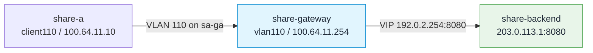
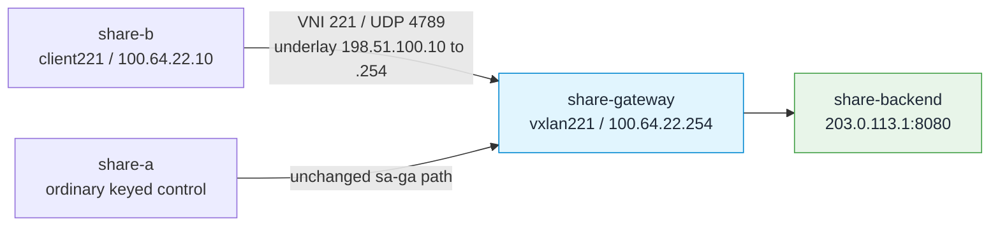

# Bind department networks to tenants

Combine authenticated identity with a departmental source network, then try trusted-interface credentials in the isolated lab. Finish each experiment by removing its binding so later scheduling tests use key identity only.

<!-- example-status-default: illustrative-only -->

Choose the identity source appropriate for your deployment: CIDR checks the actual peer subnet; ingress_if names a trusted local interface; vlan/vni resolve local software devices. Each payload below shows tenant, services, enforce and credential separately. Change services whenever the inference VIP/port changes; do not include management port 11111.

## Before you start

Complete identity and retain both departmental keys.

**Focus of this page:** Add one network binding at a time; VLAN/VXLAN devices exist inside this same software lab.

## Topology and execution locations

--8<-- "snippets/use-cases/topology/shared.md"

One disposable Linux host contains two Gateway/DB containers and four network namespaces. Support reaches the Gateway on 192.0.2.254; research uses its 198.51.100.254 interface. The backend is a host Python process in share-backend, not an inference engine. PostgreSQL uses its inspected Docker-bridge address.

| Where | What happens here |
|---|---|
| Host root Bash | Create namespaces, save LAB inputs, start/stop exact owned processes. |
| share-a / share-b | Send inference as support/research; management curls use share-a. |
| share-gateway | Apply policy and forward requests; management is port 11111, inference port 8080. |
| share-backend | Read /receipt/ and /order directly, bypassing Gateway routing. |
| share-pg | Keep keys/objectives; pause only in the explicit recovery experiment. |

## Walkthrough

### Subnet match and strict versus advisory

Complete [onboarding](identity.md). Create a support subnet binding scoped to this exact inference service; do not include the management port. `forward_identity` requires explicit services. The resolver uses actual socket peer/ingress, not a client's asserted X-Forwarded-For. NAT that hides all clients behind one peer needs another trustworthy identity signal.

**Step 1 — Apply or read back the displayed management policy**

Write `networks-config-1.request.json` with the displayed editable JSON input. Send the displayed management request to `/config/ai/netidentity` and retain its response.

```bash
set -euo pipefail
umask 077
source "${LAB:?set LAB to your private run directory}/env"
cat > "$LAB/networks-config-1.request.json" <<'JSON'
{
  "name": "support-subnet",
  "match": {
    "cidr": [
      "192.0.2.0/24"
    ]
  },
  "tenant": "support",
  "services": [
    "192.0.2.254:8080"
  ],
  "enforce": "strict",
  "priority_class": "critical",
  "forward_identity": true
}
JSON
status=$(ip netns exec share-a curl -sS --max-time 10 -X POST \
  -H 'Content-Type: application/json' --data-binary "@$LAB/networks-config-1.request.json" \
  -D "$LAB/networks-config-1.headers" -o "$LAB/networks-config-1.response.json" \
  -w '%{http_code}' "$API/config/ai/netidentity")
```

**Step 2 — Apply or read back the displayed management policy**

Require HTTP 200 for the saved management response before continuing. Send the displayed management request to `/config/ai/netidentity` and retain its response. Write `subnet-support.request.json` with the displayed editable JSON input.

```bash
printf 'HTTP %s\n' "$status"
jq . "$LAB/networks-config-1.response.json"
test "$status" = 200
status=$(ip netns exec share-a curl -sS --max-time 10 -X GET \
  -D "$LAB/networks-config-2.headers" -o "$LAB/networks-config-2.response.json" \
  -w '%{http_code}' "$API/config/ai/netidentity")
printf 'HTTP %s\n' "$status"
jq . "$LAB/networks-config-2.response.json"
test "$status" = 200
cat > "$LAB/subnet-support.request.json" <<'JSON'
{
  "model": "shared-model",
  "messages": [
    {
      "role": "user",
      "content": "subnet-support"
    }
  ],
  "max_tokens": 4
}
JSON
```

**Step 3 — Send `subnet-support` and retain the response**

Send `subnet-support` through the Gateway from the namespace shown below; retain its HTTP status and response separately. Wait for the saved client PID in this same parent Bash before checking its final response. Require saved HTTP 200 for `subnet-support`. Read `subnet-support` directly from the backend receipt endpoint; this observation bypasses the Gateway. Require backend receipt count 1 for `subnet-support`.

```bash
ip netns exec share-a curl --http1.1 -sS --max-time 55 \
  --config "$LAB/keys/support.curl" \
  -H 'Content-Type: application/json' \
  -H 'X-Test-Nonce: subnet-support' -H 'X-Request-Id: subnet-support' \
  --data-binary "@$LAB/subnet-support.request.json" \
  -D "$LAB/subnet-support.headers" -o "$LAB/subnet-support.response.json" \
  -w '%{http_code}\n' "$INFER" > "$LAB/subnet-support.http"
if test -f "$LAB/subnet-support.pid"; then
  wait "$(cat "$LAB/subnet-support.pid")"
fi
test "$(cat "$LAB/subnet-support.http")" = 200
ip netns exec share-backend curl -fsS --max-time 3 \
  "http://127.0.0.1:8080/receipt/subnet-support" -o "$LAB/subnet-support.receipt.json"
jq -e '.count == 1' "$LAB/subnet-support.receipt.json"
jq -e '((.["headers"]["x-llm-d-inference-fairness-id"] == "support"))' "$LAB/subnet-support.receipt.json"
```

**Step 4 — Send `subnet-mismatch` and retain the response**

Write `subnet-mismatch.request.json` with the displayed editable JSON input. Send `subnet-mismatch` through the Gateway from the namespace shown below; retain its HTTP status and response separately. Wait for the saved client PID in this same parent Bash before checking its final response. Require saved HTTP 403 for `subnet-mismatch`.

```bash
cat > "$LAB/subnet-mismatch.request.json" <<'JSON'
{
  "model": "shared-model",
  "messages": [
    {
      "role": "user",
      "content": "subnet-mismatch"
    }
  ],
  "max_tokens": 4
}
JSON
ip netns exec share-a curl --http1.1 -sS --max-time 55 \
  --config "$LAB/keys/research.curl" \
  -H 'Content-Type: application/json' \
  -H 'X-Test-Nonce: subnet-mismatch' -H 'X-Request-Id: subnet-mismatch' \
  --data-binary "@$LAB/subnet-mismatch.request.json" \
  -D "$LAB/subnet-mismatch.headers" -o "$LAB/subnet-mismatch.response.json" \
  -w '%{http_code}\n' "$INFER" > "$LAB/subnet-mismatch.http"
if test -f "$LAB/subnet-mismatch.pid"; then
  wait "$(cat "$LAB/subnet-mismatch.pid")"
fi
test "$(cat "$LAB/subnet-mismatch.http")" = 403
```

**Step 5 — Apply or read back the displayed management policy**

Read `subnet-mismatch` directly from the backend receipt endpoint; this observation bypasses the Gateway. Require backend receipt count 0 for `subnet-mismatch`. Write `networks-config-3.request.json` with the displayed editable JSON input. Send the displayed management request to `/config/ai/netidentity` and retain its response.

```bash
ip netns exec share-backend curl -fsS --max-time 3 \
  "http://127.0.0.1:8080/receipt/subnet-mismatch" -o "$LAB/subnet-mismatch.receipt.json"
jq -e '.count == 0' "$LAB/subnet-mismatch.receipt.json"
cat > "$LAB/networks-config-3.request.json" <<'JSON'
{
  "name": "support-subnet",
  "match": {
    "cidr": [
      "192.0.2.0/24"
    ]
  },
  "tenant": "support",
  "services": [
    "192.0.2.254:8080"
  ],
  "enforce": "advisory",
  "forward_identity": true
}
JSON
status=$(ip netns exec share-a curl -sS --max-time 10 -X POST \
  -H 'Content-Type: application/json' --data-binary "@$LAB/networks-config-3.request.json" \
  -D "$LAB/networks-config-3.headers" -o "$LAB/networks-config-3.response.json" \
  -w '%{http_code}' "$API/config/ai/netidentity")
printf 'HTTP %s\n' "$status"
```

**Step 6 — Send `advisory-key-wins` and retain the response**

Require HTTP 200 for the saved management response before continuing. Write `advisory-key-wins.request.json` with the displayed editable JSON input. Send `advisory-key-wins` through the Gateway from the namespace shown below; retain its HTTP status and response separately.

```bash
jq . "$LAB/networks-config-3.response.json"
test "$status" = 200
cat > "$LAB/advisory-key-wins.request.json" <<'JSON'
{
  "model": "shared-model",
  "messages": [
    {
      "role": "user",
      "content": "advisory-key-wins"
    }
  ],
  "max_tokens": 4
}
JSON
ip netns exec share-a curl --http1.1 -sS --max-time 55 \
  --config "$LAB/keys/research.curl" \
  -H 'Content-Type: application/json' \
  -H 'X-Test-Nonce: advisory-key-wins' -H 'X-Request-Id: advisory-key-wins' \
  -H 'X-llm-d-inference-objective: interactive' \
  --data-binary "@$LAB/advisory-key-wins.request.json" \
  -D "$LAB/advisory-key-wins.headers" -o "$LAB/advisory-key-wins.response.json" \
  -w '%{http_code}\n' "$INFER" > "$LAB/advisory-key-wins.http"
```

**Step 7 — Check independent backend delivery**

Wait for the saved client PID in this same parent Bash before checking its final response. Require saved HTTP 200 for `advisory-key-wins`. Read `advisory-key-wins` directly from the backend receipt endpoint; this observation bypasses the Gateway. Require backend receipt count 1 for `advisory-key-wins`. Write `networks-config-4.request.json` with the displayed editable JSON input.

```bash
if test -f "$LAB/advisory-key-wins.pid"; then
  wait "$(cat "$LAB/advisory-key-wins.pid")"
fi
test "$(cat "$LAB/advisory-key-wins.http")" = 200
ip netns exec share-backend curl -fsS --max-time 3 \
  "http://127.0.0.1:8080/receipt/advisory-key-wins" -o "$LAB/advisory-key-wins.receipt.json"
jq -e '.count == 1' "$LAB/advisory-key-wins.receipt.json"
jq -e '((.["headers"]["x-llm-d-inference-fairness-id"] == "research"))' "$LAB/advisory-key-wins.receipt.json"
jq -e '.headers["x-llm-d-inference-objective"] == "standard"' "$LAB/advisory-key-wins.receipt.json"
cat > "$LAB/networks-config-4.request.json" <<'JSON'
{
  "name": "support-host",
  "match": {
    "cidr": [
      "192.0.2.10/32"
    ]
  },
  "tenant": "research",
  "services": [
    "192.0.2.254:8080"
  ],
  "enforce": "strict"
}
JSON
```

**Step 8 — Apply or read back the displayed management policy**

Send the displayed management request to `/config/ai/netidentity` and retain its response. Require HTTP 200 for the saved management response before continuing. Write `longest-prefix.request.json` with the displayed editable JSON input.

```bash
status=$(ip netns exec share-a curl -sS --max-time 10 -X POST \
  -H 'Content-Type: application/json' --data-binary "@$LAB/networks-config-4.request.json" \
  -D "$LAB/networks-config-4.headers" -o "$LAB/networks-config-4.response.json" \
  -w '%{http_code}' "$API/config/ai/netidentity")
printf 'HTTP %s\n' "$status"
jq . "$LAB/networks-config-4.response.json"
test "$status" = 200
cat > "$LAB/longest-prefix.request.json" <<'JSON'
{
  "model": "shared-model",
  "messages": [
    {
      "role": "user",
      "content": "longest-prefix"
    }
  ],
  "max_tokens": 4
}
JSON
```

**Step 9 — Send `longest-prefix` and retain the response**

Send `longest-prefix` through the Gateway from the namespace shown below; retain its HTTP status and response separately. Wait for the saved client PID in this same parent Bash before checking its final response. Require saved HTTP 200 for `longest-prefix`. Read `longest-prefix` directly from the backend receipt endpoint; this observation bypasses the Gateway. Require backend receipt count 1 for `longest-prefix`.

```bash
ip netns exec share-a curl --http1.1 -sS --max-time 55 \
  --config "$LAB/keys/research.curl" \
  -H 'Content-Type: application/json' \
  -H 'X-Test-Nonce: longest-prefix' -H 'X-Request-Id: longest-prefix' \
  --data-binary "@$LAB/longest-prefix.request.json" \
  -D "$LAB/longest-prefix.headers" -o "$LAB/longest-prefix.response.json" \
  -w '%{http_code}\n' "$INFER" > "$LAB/longest-prefix.http"
if test -f "$LAB/longest-prefix.pid"; then
  wait "$(cat "$LAB/longest-prefix.pid")"
fi
test "$(cat "$LAB/longest-prefix.http")" = 200
ip netns exec share-backend curl -fsS --max-time 3 \
  "http://127.0.0.1:8080/receipt/longest-prefix" -o "$LAB/longest-prefix.receipt.json"
jq -e '.count == 1' "$LAB/longest-prefix.receipt.json"
```

**Step 10 — Apply or read back the displayed management policy**

Write `networks-config-5.request.json` with the displayed editable JSON input. Send the displayed management request to `/config/ai/netidentity` and retain its response. Require HTTP 409 for the saved management response before continuing.

```bash
cat > "$LAB/networks-config-5.request.json" <<'JSON'
{
  "name": "conflicting-host",
  "match": {
    "cidr": [
      "192.0.2.10/32"
    ]
  },
  "tenant": "support",
  "services": [
    "192.0.2.254:8080"
  ]
}
JSON
status=$(ip netns exec share-a curl -sS --max-time 10 -X POST \
  -H 'Content-Type: application/json' --data-binary "@$LAB/networks-config-5.request.json" \
  -D "$LAB/networks-config-5.headers" -o "$LAB/networks-config-5.response.json" \
  -w '%{http_code}' "$API/config/ai/netidentity")
printf 'HTTP %s\n' "$status"
jq . "$LAB/networks-config-5.response.json"
test "$status" = 409
```

**Step 11 — Send `after-conflict` and retain the response**

Write `after-conflict.request.json` with the displayed editable JSON input. Send `after-conflict` through the Gateway from the namespace shown below; retain its HTTP status and response separately. Wait for the saved client PID in this same parent Bash before checking its final response. Require saved HTTP 200 for `after-conflict`.

```bash
cat > "$LAB/after-conflict.request.json" <<'JSON'
{
  "model": "shared-model",
  "messages": [
    {
      "role": "user",
      "content": "after-conflict"
    }
  ],
  "max_tokens": 4
}
JSON
ip netns exec share-a curl --http1.1 -sS --max-time 55 \
  --config "$LAB/keys/research.curl" \
  -H 'Content-Type: application/json' \
  -H 'X-Test-Nonce: after-conflict' -H 'X-Request-Id: after-conflict' \
  --data-binary "@$LAB/after-conflict.request.json" \
  -D "$LAB/after-conflict.headers" -o "$LAB/after-conflict.response.json" \
  -w '%{http_code}\n' "$INFER" > "$LAB/after-conflict.http"
if test -f "$LAB/after-conflict.pid"; then
  wait "$(cat "$LAB/after-conflict.pid")"
fi
test "$(cat "$LAB/after-conflict.http")" = 200
```

**Step 12 — Apply or read back the displayed management policy**

Read `after-conflict` directly from the backend receipt endpoint; this observation bypasses the Gateway. Require backend receipt count 1 for `after-conflict`. Send the displayed management request to `/config/ai/netidentity/support-host` and retain its response. Require HTTP 200 for the saved management response before continuing. Send the displayed management request to `/config/ai/netidentity/support-subnet` and retain its response.

```bash
ip netns exec share-backend curl -fsS --max-time 3 \
  "http://127.0.0.1:8080/receipt/after-conflict" -o "$LAB/after-conflict.receipt.json"
jq -e '.count == 1' "$LAB/after-conflict.receipt.json"
status=$(ip netns exec share-a curl -sS --max-time 10 -X DELETE \
  -D "$LAB/networks-config-6.headers" -o "$LAB/networks-config-6.response.json" \
  -w '%{http_code}' "$API/config/ai/netidentity/support-host")
printf 'HTTP %s\n' "$status"
jq . "$LAB/networks-config-6.response.json"
test "$status" = 200
status=$(ip netns exec share-a curl -sS --max-time 10 -X DELETE \
  -D "$LAB/networks-config-7.headers" -o "$LAB/networks-config-7.response.json" \
  -w '%{http_code}' "$API/config/ai/netidentity/support-subnet")
printf 'HTTP %s\n' "$status"
jq . "$LAB/networks-config-7.response.json"
test "$status" = 200
```

Strict mismatch is 403 with receipt 0. Advisory accepts the valid credential's tenant, but the matched binding still caps its class, including a key from another tenant. An omitted `priority_class` defaults to `standard`; the advisory example requests `interactive` with the research key and must arrive as standard. VLAN, VXLAN and recovery bindings below also omit the field and therefore impose a standard cap. Set it explicitly when customizing authority. Longest-prefix match selects the /32; an equal-specificity conflicting update must not displace it. Prefer exact, nonoverlapping departmental networks in deployment. CIDR-only network credentials and unsupported IPv6 bindings are rejected:

**Step 1 — Apply or read back the displayed management policy**

Write `networks-config-8.request.json` with the displayed editable JSON input. Send the displayed management request to `/config/ai/netidentity` and retain its response. Require HTTP 400 for the saved management response before continuing.

```bash
set -euo pipefail
umask 077
source "${LAB:?set LAB to your private run directory}/env"
cat > "$LAB/networks-config-8.request.json" <<'JSON'
{
  "name": "bad-network-credential",
  "match": {
    "cidr": [
      "192.0.2.0/24"
    ]
  },
  "tenant": "support",
  "credential": "network"
}
JSON
status=$(ip netns exec share-a curl -sS --max-time 10 -X POST \
  -H 'Content-Type: application/json' --data-binary "@$LAB/networks-config-8.request.json" \
  -D "$LAB/networks-config-8.headers" -o "$LAB/networks-config-8.response.json" \
  -w '%{http_code}' "$API/config/ai/netidentity")
printf 'HTTP %s\n' "$status"
jq . "$LAB/networks-config-8.response.json"
test "$status" = 400
```

**Step 2 — Apply or read back the displayed management policy**

Write `networks-config-9.request.json` with the displayed editable JSON input. Send the displayed management request to `/config/ai/netidentity` and retain its response. Require HTTP 400 for the saved management response before continuing.

```bash
cat > "$LAB/networks-config-9.request.json" <<'JSON'
{
  "name": "bad-v6",
  "match": {
    "cidr": [
      "2001:db8::/32"
    ]
  },
  "tenant": "support"
}
JSON
status=$(ip netns exec share-a curl -sS --max-time 10 -X POST \
  -H 'Content-Type: application/json' --data-binary "@$LAB/networks-config-9.request.json" \
  -D "$LAB/networks-config-9.headers" -o "$LAB/networks-config-9.response.json" \
  -w '%{http_code}' "$API/config/ai/netidentity")
printf 'HTTP %s\n' "$status"
jq . "$LAB/networks-config-9.response.json"
test "$status" = 400
```

### Trusted ingress interface and a narrower class cap

Only use `credential:network` when access to the named ingress is controlled by your platform. It allows keyless requests matching that interface; it does not validate an arbitrary remote user. Interface binding wins over subnet matching. The block reinstates a research subnet binding while the support interface binding is present; the keyless request must still resolve to support. It removes the overlapping subnet before testing interface-binding deletion. A presented bad credential must still fail, and a valid different-tenant key must fail under strict enforcement.

**Step 1 — Apply or read back the displayed management policy**

Send the displayed management request to `/config/ai/netidentity` and retain its response. Require HTTP 200 for the saved management response before continuing.

```bash
set -euo pipefail
umask 077
source "${LAB:?set LAB to your private run directory}/env"
# Reinstate a conflicting research subnet so interface precedence is observable.
jq '.tenant = "research"' "$LAB/networks-config-1.request.json" > "$LAB/interface-overlap.request.json"
status=$(ip netns exec share-a curl -sS --max-time 10 -X POST \
  -H 'Content-Type: application/json' --data-binary "@$LAB/interface-overlap.request.json" \
  -o "$LAB/interface-overlap.response.json" -w '%{http_code}' "$API/config/ai/netidentity")
test "$status" = 200
```

**Step 2 — Apply or read back the displayed management policy**

Write `networks-config-10.request.json` with the displayed editable JSON input. Send the displayed management request to `/config/ai/netidentity` and retain its response. Require HTTP 200 for the saved management response before continuing.

```bash
cat > "$LAB/networks-config-10.request.json" <<'JSON'
{
  "name": "support-interface",
  "match": {
    "ingress_if": "ga"
  },
  "tenant": "support",
  "services": [
    "192.0.2.254:8080"
  ],
  "credential": "network",
  "enforce": "strict",
  "forward_identity": true,
  "priority_class": "standard"
}
JSON
status=$(ip netns exec share-a curl -sS --max-time 10 -X POST \
  -H 'Content-Type: application/json' --data-binary "@$LAB/networks-config-10.request.json" \
  -D "$LAB/networks-config-10.headers" -o "$LAB/networks-config-10.response.json" \
  -w '%{http_code}' "$API/config/ai/netidentity")
printf 'HTTP %s\n' "$status"
jq . "$LAB/networks-config-10.response.json"
test "$status" = 200
sleep 3
```

**Step 3 — Send `interface-keyless` and retain the response**

Write `interface-keyless.request.json` with the displayed editable JSON input. Send `interface-keyless` through the Gateway from the namespace shown below; retain its HTTP status and response separately. Wait for the saved client PID in this same parent Bash before checking its final response. Require saved HTTP 200 for `interface-keyless`. Read `interface-keyless` directly from the backend receipt endpoint; this observation bypasses the Gateway.

```bash
cat > "$LAB/interface-keyless.request.json" <<'JSON'
{
  "model": "shared-model",
  "messages": [
    {
      "role": "user",
      "content": "interface-keyless"
    }
  ],
  "max_tokens": 4
}
JSON
ip netns exec share-a curl --http1.1 -sS --max-time 55 \
  -H 'Content-Type: application/json' \
  -H 'X-Test-Nonce: interface-keyless' -H 'X-Request-Id: interface-keyless' \
  --data-binary "@$LAB/interface-keyless.request.json" \
  -D "$LAB/interface-keyless.headers" -o "$LAB/interface-keyless.response.json" \
  -w '%{http_code}\n' "$INFER" > "$LAB/interface-keyless.http"
if test -f "$LAB/interface-keyless.pid"; then
  wait "$(cat "$LAB/interface-keyless.pid")"
fi
test "$(cat "$LAB/interface-keyless.http")" = 200
ip netns exec share-backend curl -fsS --max-time 3 \
  "http://127.0.0.1:8080/receipt/interface-keyless" -o "$LAB/interface-keyless.receipt.json"
```

**Step 4 — Send `interface-bad-key` and retain the response**

Require backend receipt count 1 for `interface-keyless`. Write `interface-bad-key.request.json` with the displayed editable JSON input. Send `interface-bad-key` through the Gateway from the namespace shown below; retain its HTTP status and response separately. Wait for the saved client PID in this same parent Bash before checking its final response.

```bash
jq -e '.count == 1' "$LAB/interface-keyless.receipt.json"
jq -e '((.["headers"]["x-llm-d-inference-fairness-id"] == "support"))' "$LAB/interface-keyless.receipt.json"
cat > "$LAB/interface-bad-key.request.json" <<'JSON'
{
  "model": "shared-model",
  "messages": [
    {
      "role": "user",
      "content": "interface-bad-key"
    }
  ],
  "max_tokens": 4
}
JSON
ip netns exec share-a curl --http1.1 -sS --max-time 55 \
  -H 'Content-Type: application/json' \
  -H 'X-Test-Nonce: interface-bad-key' -H 'X-Request-Id: interface-bad-key' \
  -H "@$LAB/invalid-key.headers" \
  --data-binary "@$LAB/interface-bad-key.request.json" \
  -D "$LAB/interface-bad-key.headers" -o "$LAB/interface-bad-key.response.json" \
  -w '%{http_code}\n' "$INFER" > "$LAB/interface-bad-key.http"
if test -f "$LAB/interface-bad-key.pid"; then
  wait "$(cat "$LAB/interface-bad-key.pid")"
fi
```

**Step 5 — Send `interface-wrong-tenant` and retain the response**

Require saved HTTP 401 for `interface-bad-key`. Read `interface-bad-key` directly from the backend receipt endpoint; this observation bypasses the Gateway. Require backend receipt count 0 for `interface-bad-key`. Write `interface-wrong-tenant.request.json` with the displayed editable JSON input. Send `interface-wrong-tenant` through the Gateway from the namespace shown below; retain its HTTP status and response separately.

```bash
test "$(cat "$LAB/interface-bad-key.http")" = 401
ip netns exec share-backend curl -fsS --max-time 3 \
  "http://127.0.0.1:8080/receipt/interface-bad-key" -o "$LAB/interface-bad-key.receipt.json"
jq -e '.count == 0' "$LAB/interface-bad-key.receipt.json"
cat > "$LAB/interface-wrong-tenant.request.json" <<'JSON'
{
  "model": "shared-model",
  "messages": [
    {
      "role": "user",
      "content": "interface-wrong-tenant"
    }
  ],
  "max_tokens": 4
}
JSON
ip netns exec share-a curl --http1.1 -sS --max-time 55 \
  --config "$LAB/keys/research.curl" \
  -H 'Content-Type: application/json' \
  -H 'X-Test-Nonce: interface-wrong-tenant' -H 'X-Request-Id: interface-wrong-tenant' \
  --data-binary "@$LAB/interface-wrong-tenant.request.json" \
  -D "$LAB/interface-wrong-tenant.headers" -o "$LAB/interface-wrong-tenant.response.json" \
  -w '%{http_code}\n' "$INFER" > "$LAB/interface-wrong-tenant.http"
```

**Step 6 — Check independent backend delivery**

Wait for the saved client PID in this same parent Bash before checking its final response. Require saved HTTP 403 for `interface-wrong-tenant`. Read `interface-wrong-tenant` directly from the backend receipt endpoint; this observation bypasses the Gateway. Require backend receipt count 0 for `interface-wrong-tenant`. Write `interface-capped.request.json` with the displayed editable JSON input.

```bash
if test -f "$LAB/interface-wrong-tenant.pid"; then
  wait "$(cat "$LAB/interface-wrong-tenant.pid")"
fi
test "$(cat "$LAB/interface-wrong-tenant.http")" = 403
ip netns exec share-backend curl -fsS --max-time 3 \
  "http://127.0.0.1:8080/receipt/interface-wrong-tenant" -o "$LAB/interface-wrong-tenant.receipt.json"
jq -e '.count == 0' "$LAB/interface-wrong-tenant.receipt.json"
cat > "$LAB/interface-capped.request.json" <<'JSON'
{
  "model": "shared-model",
  "messages": [
    {
      "role": "user",
      "content": "interface-capped"
    }
  ],
  "max_tokens": 4
}
JSON
```

**Step 7 — Send `interface-capped` and retain the response**

Send `interface-capped` through the Gateway from the namespace shown below; retain its HTTP status and response separately. Wait for the saved client PID in this same parent Bash before checking its final response. Require saved HTTP 200 for `interface-capped`. Read `interface-capped` directly from the backend receipt endpoint; this observation bypasses the Gateway. Require backend receipt count 1 for `interface-capped`.

```bash
ip netns exec share-a curl --http1.1 -sS --max-time 55 \
  --config "$LAB/keys/support.curl" \
  -H 'Content-Type: application/json' \
  -H 'X-Test-Nonce: interface-capped' -H 'X-Request-Id: interface-capped' \
  -H x-llm-d-inference-objective:interactive \
  --data-binary "@$LAB/interface-capped.request.json" \
  -D "$LAB/interface-capped.headers" -o "$LAB/interface-capped.response.json" \
  -w '%{http_code}\n' "$INFER" > "$LAB/interface-capped.http"
if test -f "$LAB/interface-capped.pid"; then
  wait "$(cat "$LAB/interface-capped.pid")"
fi
test "$(cat "$LAB/interface-capped.http")" = 200
ip netns exec share-backend curl -fsS --max-time 3 \
  "http://127.0.0.1:8080/receipt/interface-capped" -o "$LAB/interface-capped.receipt.json"
jq -e '.count == 1' "$LAB/interface-capped.receipt.json"
jq -e '((.["headers"]["x-llm-d-inference-objective"] == "standard"))' "$LAB/interface-capped.receipt.json"
```

**Step 8 — Send `forwarded-spoof` and retain the response**

Write `forwarded-spoof.request.json` with the displayed editable JSON input. Send `forwarded-spoof` through the Gateway from the namespace shown below; retain its HTTP status and response separately. Wait for the saved client PID in this same parent Bash before checking its final response. Require saved HTTP 200 for `forwarded-spoof`.

```bash
cat > "$LAB/forwarded-spoof.request.json" <<'JSON'
{
  "model": "shared-model",
  "messages": [
    {
      "role": "user",
      "content": "forwarded-spoof"
    }
  ],
  "max_tokens": 4
}
JSON
ip netns exec share-a curl --http1.1 -sS --max-time 55 \
  -H 'Content-Type: application/json' \
  -H 'X-Test-Nonce: forwarded-spoof' -H 'X-Request-Id: forwarded-spoof' \
  -H X-Forwarded-For:198.51.100.10 \
  -H X-Auth-Tenant:research \
  --data-binary "@$LAB/forwarded-spoof.request.json" \
  -D "$LAB/forwarded-spoof.headers" -o "$LAB/forwarded-spoof.response.json" \
  -w '%{http_code}\n' "$INFER" > "$LAB/forwarded-spoof.http"
if test -f "$LAB/forwarded-spoof.pid"; then
  wait "$(cat "$LAB/forwarded-spoof.pid")"
fi
test "$(cat "$LAB/forwarded-spoof.http")" = 200
```

**Step 9 — Apply or read back the displayed management policy**

Read `forwarded-spoof` directly from the backend receipt endpoint; this observation bypasses the Gateway. Require backend receipt count 1 for `forwarded-spoof`. Send the displayed management request to `/config/ai/netidentity/support-subnet` and retain its response. Require HTTP 200 for the saved management response before continuing. Send the displayed management request to `/config/ai/netidentity/support-interface` and retain its response.

```bash
ip netns exec share-backend curl -fsS --max-time 3 \
  "http://127.0.0.1:8080/receipt/forwarded-spoof" -o "$LAB/forwarded-spoof.receipt.json"
jq -e '.count == 1' "$LAB/forwarded-spoof.receipt.json"
jq -e '((.["headers"]["x-llm-d-inference-fairness-id"] == "support"))' "$LAB/forwarded-spoof.receipt.json"
jq -e '.headers["x-auth-tenant"] == "support"' "$LAB/forwarded-spoof.receipt.json"
# Remove the overlap before testing absence of all interface credentials.
status=$(ip netns exec share-a curl -sS --max-time 10 -X DELETE \
  -o "$LAB/interface-overlap-delete.response.json" -w '%{http_code}' "$API/config/ai/netidentity/support-subnet")
test "$status" = 200
status=$(ip netns exec share-a curl -sS --max-time 10 -X DELETE \
  -D "$LAB/networks-config-11.headers" -o "$LAB/networks-config-11.response.json" \
  -w '%{http_code}' "$API/config/ai/netidentity/support-interface")
printf 'HTTP %s\n' "$status"
jq . "$LAB/networks-config-11.response.json"
test "$status" = 200
```

**Step 10 — Send `interface-removed` and retain the response**

Write `interface-removed.request.json` with the displayed editable JSON input. Send `interface-removed` through the Gateway from the namespace shown below; retain its HTTP status and response separately. Wait for the saved client PID in this same parent Bash before checking its final response. Require saved HTTP 401 for `interface-removed`. Read `interface-removed` directly from the backend receipt endpoint; this observation bypasses the Gateway.

```bash
cat > "$LAB/interface-removed.request.json" <<'JSON'
{
  "model": "shared-model",
  "messages": [
    {
      "role": "user",
      "content": "interface-removed"
    }
  ],
  "max_tokens": 4
}
JSON
ip netns exec share-a curl --http1.1 -sS --max-time 55 \
  -H 'Content-Type: application/json' \
  -H 'X-Test-Nonce: interface-removed' -H 'X-Request-Id: interface-removed' \
  --data-binary "@$LAB/interface-removed.request.json" \
  -D "$LAB/interface-removed.headers" -o "$LAB/interface-removed.response.json" \
  -w '%{http_code}\n' "$INFER" > "$LAB/interface-removed.http"
if test -f "$LAB/interface-removed.pid"; then
  wait "$(cat "$LAB/interface-removed.pid")"
fi
test "$(cat "$LAB/interface-removed.http")" = 401
ip netns exec share-backend curl -fsS --max-time 3 \
  "http://127.0.0.1:8080/receipt/interface-removed" -o "$LAB/interface-removed.receipt.json"
```

**Step 11 — Assert the saved backend receipt count**

Require backend receipt count 0 for `interface-removed`.

```bash
jq -e '.count == 0' "$LAB/interface-removed.receipt.json"
```

### Software VLAN: tagged packets, recreation and removal



The new 100.64.11.0/24 addresses belong only to these two software VLAN interfaces. The client installs a host route to the existing service VIP through the tagged Gateway interface; the backend path is unchanged.

Create VLAN devices on both ends of the existing support veth. The Gateway alias name `vlan110` is intentional: the supported VLAN binding resolves the local software device to its current ifindex. Here `vlan110` is a Linux 802.1Q subinterface, not a bridge. The lab checks tagged traffic, actual link type/ifindex and resolution after recreation; it does not configure an external switch or prove physical fabric isolation.

**Step 1 — Configure or inspect the named lab resource**

Run on the Linux host. The namespace/container name selects where the operation takes effect; confirm it belongs to this lab before adapting addresses or deleting anything.

```bash
set -euo pipefail
umask 077
source "${LAB:?set LAB to your private run directory}/env"
ip netns exec share-gateway ip link add link ga name vlan110 type vlan id 110
ip netns exec share-gateway ip addr add 100.64.11.254/24 dev vlan110
ip netns exec share-gateway ip link set vlan110 up
ip netns exec share-a ip link add link sa name client110 type vlan id 110
ip netns exec share-a ip addr add 100.64.11.10/24 dev client110
ip netns exec share-a ip link set client110 up
ip netns exec share-a ip route replace 192.0.2.254/32 via 100.64.11.254
```

**Step 2 — Apply or read back the displayed management policy**

Write `networks-config-12.request.json` with the displayed editable JSON input. Send the displayed management request to `/config/ai/netidentity` and retain its response. Require HTTP 200 for the saved management response before continuing.

```bash
cat > "$LAB/networks-config-12.request.json" <<'JSON'
{
  "name": "support-vlan",
  "match": {
    "vlan": 110
  },
  "tenant": "support",
  "services": [
    "192.0.2.254:8080"
  ],
  "credential": "network",
  "enforce": "strict",
  "forward_identity": true
}
JSON
status=$(ip netns exec share-a curl -sS --max-time 10 -X POST \
  -H 'Content-Type: application/json' --data-binary "@$LAB/networks-config-12.request.json" \
  -D "$LAB/networks-config-12.headers" -o "$LAB/networks-config-12.response.json" \
  -w '%{http_code}' "$API/config/ai/netidentity")
printf 'HTTP %s\n' "$status"
jq . "$LAB/networks-config-12.response.json"
test "$status" = 200
sleep 3
```

**Step 3 — Send `vlan-keyless` and retain the response**

Write `vlan-keyless.request.json` with the displayed editable JSON input. Send `vlan-keyless` through the Gateway from the namespace shown below; retain its HTTP status and response separately. Wait for the saved client PID in this same parent Bash before checking its final response. Require saved HTTP 200 for `vlan-keyless`. Read `vlan-keyless` directly from the backend receipt endpoint; this observation bypasses the Gateway.

```bash
cat > "$LAB/vlan-keyless.request.json" <<'JSON'
{
  "model": "shared-model",
  "messages": [
    {
      "role": "user",
      "content": "vlan-keyless"
    }
  ],
  "max_tokens": 4
}
JSON
ip netns exec share-a curl --http1.1 -sS --max-time 55 \
  -H 'Content-Type: application/json' \
  -H 'X-Test-Nonce: vlan-keyless' -H 'X-Request-Id: vlan-keyless' \
  --data-binary "@$LAB/vlan-keyless.request.json" \
  -D "$LAB/vlan-keyless.headers" -o "$LAB/vlan-keyless.response.json" \
  -w '%{http_code}\n' "$INFER" > "$LAB/vlan-keyless.http"
if test -f "$LAB/vlan-keyless.pid"; then
  wait "$(cat "$LAB/vlan-keyless.pid")"
fi
test "$(cat "$LAB/vlan-keyless.http")" = 200
ip netns exec share-backend curl -fsS --max-time 3 \
  "http://127.0.0.1:8080/receipt/vlan-keyless" -o "$LAB/vlan-keyless.receipt.json"
```

**Step 4 — Send `vlan-wrong-key` and retain the response**

Require backend receipt count 1 for `vlan-keyless`. Write `vlan-wrong-key.request.json` with the displayed editable JSON input. Send `vlan-wrong-key` through the Gateway from the namespace shown below; retain its HTTP status and response separately. Wait for the saved client PID in this same parent Bash before checking its final response.

```bash
jq -e '.count == 1' "$LAB/vlan-keyless.receipt.json"
jq -e '((.["headers"]["x-llm-d-inference-fairness-id"] == "support"))' "$LAB/vlan-keyless.receipt.json"
cat > "$LAB/vlan-wrong-key.request.json" <<'JSON'
{
  "model": "shared-model",
  "messages": [
    {
      "role": "user",
      "content": "vlan-wrong-key"
    }
  ],
  "max_tokens": 4
}
JSON
ip netns exec share-a curl --http1.1 -sS --max-time 55 \
  --config "$LAB/keys/research.curl" \
  -H 'Content-Type: application/json' \
  -H 'X-Test-Nonce: vlan-wrong-key' -H 'X-Request-Id: vlan-wrong-key' \
  --data-binary "@$LAB/vlan-wrong-key.request.json" \
  -D "$LAB/vlan-wrong-key.headers" -o "$LAB/vlan-wrong-key.response.json" \
  -w '%{http_code}\n' "$INFER" > "$LAB/vlan-wrong-key.http"
if test -f "$LAB/vlan-wrong-key.pid"; then
  wait "$(cat "$LAB/vlan-wrong-key.pid")"
fi
```

**Step 5 — Check independent backend delivery**

Require saved HTTP 403 for `vlan-wrong-key`. Read `vlan-wrong-key` directly from the backend receipt endpoint; this observation bypasses the Gateway. Require backend receipt count 0 for `vlan-wrong-key`.

```bash
test "$(cat "$LAB/vlan-wrong-key.http")" = 403
ip netns exec share-backend curl -fsS --max-time 3 \
  "http://127.0.0.1:8080/receipt/vlan-wrong-key" -o "$LAB/vlan-wrong-key.receipt.json"
jq -e '.count == 0' "$LAB/vlan-wrong-key.receipt.json"
ip netns exec share-gateway ip -s -d link show vlan110
ip netns exec share-gateway ip -j link show vlan110 > "$LAB/vlan-before.json"
ip netns exec share-gateway ip link del vlan110
ip netns exec share-gateway ip link add link ga name vlan110 type vlan id 110
ip netns exec share-gateway ip addr add 100.64.11.254/24 dev vlan110
ip netns exec share-gateway ip link set vlan110 up
sleep 4
ip netns exec share-gateway ip -j link show vlan110 > "$LAB/vlan-after.json"
test "$(jq '.[0].ifindex' "$LAB/vlan-before.json")" != "$(jq '.[0].ifindex' "$LAB/vlan-after.json")"
```

**Step 6 — Send `vlan-recreated` and retain the response**

Write `vlan-recreated.request.json` with the displayed editable JSON input. Send `vlan-recreated` through the Gateway from the namespace shown below; retain its HTTP status and response separately. Wait for the saved client PID in this same parent Bash before checking its final response. Require saved HTTP 200 for `vlan-recreated`. Read `vlan-recreated` directly from the backend receipt endpoint; this observation bypasses the Gateway.

```bash
cat > "$LAB/vlan-recreated.request.json" <<'JSON'
{
  "model": "shared-model",
  "messages": [
    {
      "role": "user",
      "content": "vlan-recreated"
    }
  ],
  "max_tokens": 4
}
JSON
ip netns exec share-a curl --http1.1 -sS --max-time 55 \
  -H 'Content-Type: application/json' \
  -H 'X-Test-Nonce: vlan-recreated' -H 'X-Request-Id: vlan-recreated' \
  --data-binary "@$LAB/vlan-recreated.request.json" \
  -D "$LAB/vlan-recreated.headers" -o "$LAB/vlan-recreated.response.json" \
  -w '%{http_code}\n' "$INFER" > "$LAB/vlan-recreated.http"
if test -f "$LAB/vlan-recreated.pid"; then
  wait "$(cat "$LAB/vlan-recreated.pid")"
fi
test "$(cat "$LAB/vlan-recreated.http")" = 200
ip netns exec share-backend curl -fsS --max-time 3 \
  "http://127.0.0.1:8080/receipt/vlan-recreated" -o "$LAB/vlan-recreated.receipt.json"
```

**Step 7 — Apply or read back the displayed management policy**

Require backend receipt count 1 for `vlan-recreated`. Send the displayed management request to `/config/ai/netidentity/support-vlan` and retain its response. Require HTTP 200 for the saved management response before continuing. Write `vlan-no-binding.request.json` with the displayed editable JSON input.

```bash
jq -e '.count == 1' "$LAB/vlan-recreated.receipt.json"
status=$(ip netns exec share-a curl -sS --max-time 10 -X DELETE \
  -D "$LAB/networks-config-13.headers" -o "$LAB/networks-config-13.response.json" \
  -w '%{http_code}' "$API/config/ai/netidentity/support-vlan")
printf 'HTTP %s\n' "$status"
jq . "$LAB/networks-config-13.response.json"
test "$status" = 200
cat > "$LAB/vlan-no-binding.request.json" <<'JSON'
{
  "model": "shared-model",
  "messages": [
    {
      "role": "user",
      "content": "vlan-no-binding"
    }
  ],
  "max_tokens": 4
}
JSON
```

**Step 8 — Send `vlan-no-binding` and retain the response**

Send `vlan-no-binding` through the Gateway from the namespace shown below; retain its HTTP status and response separately. Wait for the saved client PID in this same parent Bash before checking its final response. Require saved HTTP 401 for `vlan-no-binding`. Read `vlan-no-binding` directly from the backend receipt endpoint; this observation bypasses the Gateway. Require backend receipt count 0 for `vlan-no-binding`.

```bash
ip netns exec share-a curl --http1.1 -sS --max-time 55 \
  -H 'Content-Type: application/json' \
  -H 'X-Test-Nonce: vlan-no-binding' -H 'X-Request-Id: vlan-no-binding' \
  --data-binary "@$LAB/vlan-no-binding.request.json" \
  -D "$LAB/vlan-no-binding.headers" -o "$LAB/vlan-no-binding.response.json" \
  -w '%{http_code}\n' "$INFER" > "$LAB/vlan-no-binding.http"
if test -f "$LAB/vlan-no-binding.pid"; then
  wait "$(cat "$LAB/vlan-no-binding.pid")"
fi
test "$(cat "$LAB/vlan-no-binding.http")" = 401
ip netns exec share-backend curl -fsS --max-time 3 \
  "http://127.0.0.1:8080/receipt/vlan-no-binding" -o "$LAB/vlan-no-binding.receipt.json"
jq -e '.count == 0' "$LAB/vlan-no-binding.receipt.json"
ip netns exec share-a ip route del 192.0.2.254/32
ip netns exec share-a ip link del client110
ip netns exec share-gateway ip link del vlan110
```

Expect RX packets on vlan110, a changed ifindex after recreation, successful keyless traffic after refresh, then receipt 0 after deleting the binding. A stored alias alone is not a packet-path check.

### VXLAN: encapsulated client and underlay failure



The overlay uses 100.64.22.0/24; the existing research veth network is its underlay. Only the overlay device is interrupted. Keep the independent support path as a normal control while testing research recovery.

Create a VNI 221 overlay over the research underlay, then interrupt only the Gateway's overlay device. Key-based support traffic must remain healthy. Match `vni` resolves the Gateway-local `vxlan221` device; this is node-local configuration, so configure and verify each serving node separately.

**Step 1 — Configure or inspect the named lab resource**

Run on the Linux host. The namespace/container name selects where the operation takes effect; confirm it belongs to this lab before adapting addresses or deleting anything.

```bash
set -euo pipefail
umask 077
source "${LAB:?set LAB to your private run directory}/env"
ip netns exec share-gateway ip link add vxlan221 type vxlan id 221 local 198.51.100.254 remote 198.51.100.10 dstport 4789 nolearning
ip netns exec share-gateway ip addr add 100.64.22.254/24 dev vxlan221
ip netns exec share-gateway ip link set vxlan221 up
ip netns exec share-b ip link add client221 type vxlan id 221 local 198.51.100.10 remote 198.51.100.254 dstport 4789 nolearning
ip netns exec share-b ip addr add 100.64.22.10/24 dev client221
ip netns exec share-b ip link set client221 up
ip netns exec share-b ip route replace 192.0.2.254/32 via 100.64.22.254
```

**Step 2 — Apply or read back the displayed management policy**

Write `networks-config-14.request.json` with the displayed editable JSON input. Send the displayed management request to `/config/ai/netidentity` and retain its response. Require HTTP 200 for the saved management response before continuing.

```bash
cat > "$LAB/networks-config-14.request.json" <<'JSON'
{
  "name": "research-overlay",
  "match": {
    "vni": 221
  },
  "tenant": "research",
  "services": [
    "192.0.2.254:8080"
  ],
  "credential": "network",
  "enforce": "strict",
  "forward_identity": true
}
JSON
status=$(ip netns exec share-a curl -sS --max-time 10 -X POST \
  -H 'Content-Type: application/json' --data-binary "@$LAB/networks-config-14.request.json" \
  -D "$LAB/networks-config-14.headers" -o "$LAB/networks-config-14.response.json" \
  -w '%{http_code}' "$API/config/ai/netidentity")
printf 'HTTP %s\n' "$status"
jq . "$LAB/networks-config-14.response.json"
test "$status" = 200
sleep 3
```

**Step 3 — Send `vxlan-keyless` and retain the response**

Write `vxlan-keyless.request.json` with the displayed editable JSON input. Send `vxlan-keyless` through the Gateway from the namespace shown below; retain its HTTP status and response separately. Wait for the saved client PID in this same parent Bash before checking its final response. Require saved HTTP 200 for `vxlan-keyless`. Read `vxlan-keyless` directly from the backend receipt endpoint; this observation bypasses the Gateway.

```bash
cat > "$LAB/vxlan-keyless.request.json" <<'JSON'
{
  "model": "shared-model",
  "messages": [
    {
      "role": "user",
      "content": "vxlan-keyless"
    }
  ],
  "max_tokens": 4
}
JSON
ip netns exec share-b curl --http1.1 -sS --max-time 55 \
  -H 'Content-Type: application/json' \
  -H 'X-Test-Nonce: vxlan-keyless' -H 'X-Request-Id: vxlan-keyless' \
  --data-binary "@$LAB/vxlan-keyless.request.json" \
  -D "$LAB/vxlan-keyless.headers" -o "$LAB/vxlan-keyless.response.json" \
  -w '%{http_code}\n' "$INFER" > "$LAB/vxlan-keyless.http"
if test -f "$LAB/vxlan-keyless.pid"; then
  wait "$(cat "$LAB/vxlan-keyless.pid")"
fi
test "$(cat "$LAB/vxlan-keyless.http")" = 200
ip netns exec share-backend curl -fsS --max-time 3 \
  "http://127.0.0.1:8080/receipt/vxlan-keyless" -o "$LAB/vxlan-keyless.receipt.json"
```

**Step 4 — Send `vxlan-wrong-key` and retain the response**

Require backend receipt count 1 for `vxlan-keyless`. Write `vxlan-wrong-key.request.json` with the displayed editable JSON input. Send `vxlan-wrong-key` through the Gateway from the namespace shown below; retain its HTTP status and response separately. Wait for the saved client PID in this same parent Bash before checking its final response.

```bash
jq -e '.count == 1' "$LAB/vxlan-keyless.receipt.json"
jq -e '((.["headers"]["x-llm-d-inference-fairness-id"] == "research"))' "$LAB/vxlan-keyless.receipt.json"
cat > "$LAB/vxlan-wrong-key.request.json" <<'JSON'
{
  "model": "shared-model",
  "messages": [
    {
      "role": "user",
      "content": "vxlan-wrong-key"
    }
  ],
  "max_tokens": 4
}
JSON
ip netns exec share-b curl --http1.1 -sS --max-time 55 \
  --config "$LAB/keys/support.curl" \
  -H 'Content-Type: application/json' \
  -H 'X-Test-Nonce: vxlan-wrong-key' -H 'X-Request-Id: vxlan-wrong-key' \
  --data-binary "@$LAB/vxlan-wrong-key.request.json" \
  -D "$LAB/vxlan-wrong-key.headers" -o "$LAB/vxlan-wrong-key.response.json" \
  -w '%{http_code}\n' "$INFER" > "$LAB/vxlan-wrong-key.http"
if test -f "$LAB/vxlan-wrong-key.pid"; then
  wait "$(cat "$LAB/vxlan-wrong-key.pid")"
fi
```

**Step 5 — Check independent backend delivery**

Require saved HTTP 403 for `vxlan-wrong-key`. Read `vxlan-wrong-key` directly from the backend receipt endpoint; this observation bypasses the Gateway. Require backend receipt count 0 for `vxlan-wrong-key`. Write `overlay-other-path.request.json` with the displayed editable JSON input.

```bash
test "$(cat "$LAB/vxlan-wrong-key.http")" = 403
ip netns exec share-backend curl -fsS --max-time 3 \
  "http://127.0.0.1:8080/receipt/vxlan-wrong-key" -o "$LAB/vxlan-wrong-key.receipt.json"
jq -e '.count == 0' "$LAB/vxlan-wrong-key.receipt.json"
ip netns exec share-gateway ip -s -d link show vxlan221
ip netns exec share-gateway ip link set vxlan221 down
# No HTTP response is expected; save the transport error separately.
ip netns exec share-b curl -sS --max-time 2 -o "$LAB/vxlan-down.body" -w '%{http_code}\n' http://192.0.2.254:8080/v1/models > "$LAB/vxlan-down.code" 2> "$LAB/vxlan-down.stderr" && exit 1
cat > "$LAB/overlay-other-path.request.json" <<'JSON'
{
  "model": "shared-model",
  "messages": [
    {
      "role": "user",
      "content": "overlay-other-path"
    }
  ],
  "max_tokens": 4
}
JSON
```

**Step 6 — Send `overlay-other-path` and retain the response**

Send `overlay-other-path` through the Gateway from the namespace shown below; retain its HTTP status and response separately. Wait for the saved client PID in this same parent Bash before checking its final response. Require saved HTTP 200 for `overlay-other-path`. Read `overlay-other-path` directly from the backend receipt endpoint; this observation bypasses the Gateway. Require backend receipt count 1 for `overlay-other-path`.

```bash
ip netns exec share-a curl --http1.1 -sS --max-time 55 \
  --config "$LAB/keys/support.curl" \
  -H 'Content-Type: application/json' \
  -H 'X-Test-Nonce: overlay-other-path' -H 'X-Request-Id: overlay-other-path' \
  --data-binary "@$LAB/overlay-other-path.request.json" \
  -D "$LAB/overlay-other-path.headers" -o "$LAB/overlay-other-path.response.json" \
  -w '%{http_code}\n' "$INFER" > "$LAB/overlay-other-path.http"
if test -f "$LAB/overlay-other-path.pid"; then
  wait "$(cat "$LAB/overlay-other-path.pid")"
fi
test "$(cat "$LAB/overlay-other-path.http")" = 200
ip netns exec share-backend curl -fsS --max-time 3 \
  "http://127.0.0.1:8080/receipt/overlay-other-path" -o "$LAB/overlay-other-path.receipt.json"
jq -e '.count == 1' "$LAB/overlay-other-path.receipt.json"
ip netns exec share-gateway ip link set vxlan221 up
sleep 3
```

**Step 7 — Send `vxlan-recovered` and retain the response**

Write `vxlan-recovered.request.json` with the displayed editable JSON input. Send `vxlan-recovered` through the Gateway from the namespace shown below; retain its HTTP status and response separately. Wait for the saved client PID in this same parent Bash before checking its final response. Require saved HTTP 200 for `vxlan-recovered`. Read `vxlan-recovered` directly from the backend receipt endpoint; this observation bypasses the Gateway.

```bash
cat > "$LAB/vxlan-recovered.request.json" <<'JSON'
{
  "model": "shared-model",
  "messages": [
    {
      "role": "user",
      "content": "vxlan-recovered"
    }
  ],
  "max_tokens": 4
}
JSON
ip netns exec share-b curl --http1.1 -sS --max-time 55 \
  -H 'Content-Type: application/json' \
  -H 'X-Test-Nonce: vxlan-recovered' -H 'X-Request-Id: vxlan-recovered' \
  --data-binary "@$LAB/vxlan-recovered.request.json" \
  -D "$LAB/vxlan-recovered.headers" -o "$LAB/vxlan-recovered.response.json" \
  -w '%{http_code}\n' "$INFER" > "$LAB/vxlan-recovered.http"
if test -f "$LAB/vxlan-recovered.pid"; then
  wait "$(cat "$LAB/vxlan-recovered.pid")"
fi
test "$(cat "$LAB/vxlan-recovered.http")" = 200
ip netns exec share-backend curl -fsS --max-time 3 \
  "http://127.0.0.1:8080/receipt/vxlan-recovered" -o "$LAB/vxlan-recovered.receipt.json"
```

**Step 8 — Apply or read back the displayed management policy**

Require backend receipt count 1 for `vxlan-recovered`. Send the displayed management request to `/config/ai/netidentity/research-overlay` and retain its response. Require HTTP 200 for the saved management response before continuing. Write `vxlan-no-binding.request.json` with the displayed editable JSON input.

```bash
jq -e '.count == 1' "$LAB/vxlan-recovered.receipt.json"
status=$(ip netns exec share-a curl -sS --max-time 10 -X DELETE \
  -D "$LAB/networks-config-15.headers" -o "$LAB/networks-config-15.response.json" \
  -w '%{http_code}' "$API/config/ai/netidentity/research-overlay")
printf 'HTTP %s\n' "$status"
jq . "$LAB/networks-config-15.response.json"
test "$status" = 200
cat > "$LAB/vxlan-no-binding.request.json" <<'JSON'
{
  "model": "shared-model",
  "messages": [
    {
      "role": "user",
      "content": "vxlan-no-binding"
    }
  ],
  "max_tokens": 4
}
JSON
```

**Step 9 — Send `vxlan-no-binding` and retain the response**

Send `vxlan-no-binding` through the Gateway from the namespace shown below; retain its HTTP status and response separately. Wait for the saved client PID in this same parent Bash before checking its final response. Require saved HTTP 401 for `vxlan-no-binding`. Read `vxlan-no-binding` directly from the backend receipt endpoint; this observation bypasses the Gateway. Require backend receipt count 0 for `vxlan-no-binding`.

```bash
ip netns exec share-b curl --http1.1 -sS --max-time 55 \
  -H 'Content-Type: application/json' \
  -H 'X-Test-Nonce: vxlan-no-binding' -H 'X-Request-Id: vxlan-no-binding' \
  --data-binary "@$LAB/vxlan-no-binding.request.json" \
  -D "$LAB/vxlan-no-binding.headers" -o "$LAB/vxlan-no-binding.response.json" \
  -w '%{http_code}\n' "$INFER" > "$LAB/vxlan-no-binding.http"
if test -f "$LAB/vxlan-no-binding.pid"; then
  wait "$(cat "$LAB/vxlan-no-binding.pid")"
fi
test "$(cat "$LAB/vxlan-no-binding.http")" = 401
ip netns exec share-backend curl -fsS --max-time 3 \
  "http://127.0.0.1:8080/receipt/vxlan-no-binding" -o "$LAB/vxlan-no-binding.receipt.json"
jq -e '.count == 0' "$LAB/vxlan-no-binding.receipt.json"
ip netns exec share-b ip route del 192.0.2.254/32
ip netns exec share-b ip link del client221
ip netns exec share-gateway ip link del vxlan221
```

If a path fails, inspect routes, rp_filter, local device name/ifindex, alias refresh and actual packets before diagnosing tenant policy. A nonexistent interface may be accepted with a warning while matching no traffic. Do not substitute a GET-success claim for traffic attribution. Continue to [dispatch](scheduling.md).

## Check your result

Use strict/advisory mismatch, tagged/encapsulated packets, device recreation and keyless receipt evidence separately.

Keep the configured policy, HTTP status, resolved identity, and independent backend receipt together. A rejected request must have receipt 0; a successful request must have receipt 1. A missing receipt response is a failed observation, never a zero.

## Next steps and cleanup

Continue in the documented order with the same LAB. Remove an experiment's binding or temporary rule before the next experiment; stop the shared lab only at the final cleanup chapter. Read the [lab starting point](setup.md) if required values are missing. Use [cleanup and recovery](cleanup.md) when ending the run.
